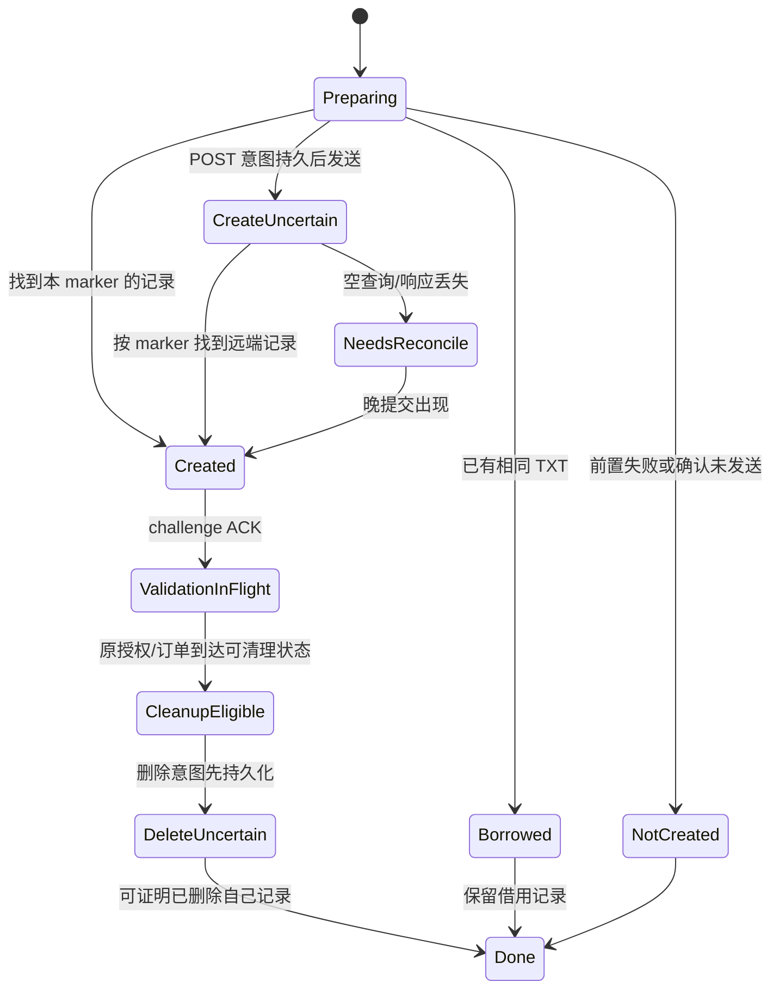

# ACME 专项审查与隔离实验

本轮对照 `13e2271f5ec994af510af4b7606de09f05bb1b5a`，开始时本地 HEAD 和远端 main 均为该提交，工作区干净。没有把历史测试记录当作本次通过。本次修改仅实现隔离夹具、回归断言、测试专用观测及报告；下述生产修复尚未实施。revision 4、逐流认证、exporter/transcript/proof、代理拨号顺序和代理数据路径保持原样。

## 固定依赖与兼容性

| 项目 | 当前源码/契约 | 本次验证与边界 |
|---|---|---|
| instant-acme | 0.9.0；UPSTREAM_REVISION `4a9b80fdc22f23ab39b78dfd20ff5d4c92938e52`；Cargo.lock 与 vendor 独立 Cargo.lock 均保持原样 | 固定提交与本地目录 patch，不以最新上游行为替代本版源码 |
| 本地补丁 | `vendor/instant-acme/MOON-PATCH.md`：增加 `AccountBuilder::create_with_key`，委托 `create_inner` | 保留持久 PKCS#8 密钥注册及一次性 EAB 恢复；本轮未改 vendor 协议代码 |
| 生产 feature graph | 根 Cargo.toml：default-features=false，仅 time、x509-parser | 不启用 ring、rcgen、hyper-rustls 默认后端；rustls-pki-types 是 DER/密钥类型，不是第二套运行时 TLS |
| CryptoProvider | `src/acme/crypto.rs::CRYPTO` 使用 BoringSSL P-256、SHA-256、HMAC | 单元测试、独立服务端验证与 pcap 的独立 Python verifier 检查 ES256 64 字节 r\|\|s、JWK thumbprint、PKCS#8 恢复；不将 DER ECDSA 签名误当 JOSE |
| HttpClient | `src/acme/http.rs::Http`，BoringSSL + Tokio/Hyper HTTP/1，验证 CA 和逻辑主机名，保留 URL 的 path/query | 真实 HTTPS、超时/取消/有限 body；library 的 nonce/JWS/EAB 继续复用。连接逐请求关闭，没有增加生产连接池 |
| CSR/finalize | `certificate.rs::csr` 返回 PKCS#8 PEM 私钥和 DER CSR；`Order::finalize_csr` 内部 base64url 编码 | 真实 Pebble 接受；独立解析请求 CSR 的签名及 DNS SAN；不额外 base64 编码 DER 入参 |
| EAB | `eab.rs::register` 使用持久账户 key 和库内 HS256/JWS | Pebble 要求 EAB；独立从解密请求验证 HS256。EAB 文件移除后凭账户恢复；不逐次续期重新注册 |
| 订单恢复 | `manager.rs::reconcile` 复用保存 URL/key/CSR，Ready 才 finalize，Processing/Valid 直接取证书 | future-notBefore 恢复不重复 finalize；404 归因仍有缺陷，见下表 |
| 依赖独立测试 | vendor 自有锁文件和生产 feature 组合 | 仅适用的无默认后端 library 测试；没有为了扩大测试数启用默认 TLS/签发后端 |

本次完整代码检查覆盖 account/crypto/eab/http/manager/dns/porkbun/state/store/certificate、runtime/TLS/CLI/配置与 xtask 入口；引用只针对下列具体路径，不声称穷尽所有库代码。

实验环境为 Rust 1.93.0、Linux GNU x86_64；完整 rustc、内核/CPU、feature graph、锁文件摘要和工具二进制摘要在每次运行的 `baseline.json`。Pebble v2.8.0 固定 commit `d52948ce25e7c1576bcd18ff0e20a1c24ec7c44b`，仅应用仓库可审阅的 keylog/barrier 测试补丁。Go 1.27.3、tcpdump 4.99.5、tshark 4.4.18；版本和下载清单保留在工作区。没有真实 CA 订单、公网 DNS 修改或生产凭据实验。

## 当前代码结论

下列源码位置相对于本轮测试改动后的文件；生产逻辑与参考 HEAD 一致。具体 case/帧号和 journal 对照见后文证据。P1 表示可阻断签发/恢复或现有服务，P2 表示调度/诊断策略问题；不据此宣称存在可公网利用的攻击。

| 优先级/分类 | 文件、符号 | 前置条件与触发顺序 | 后果、状态与置信度 |
|---|---|---|---|
| P1 确定缺陷 | [manager.rs:311](../src/acme/manager.rs#L311) `reconcile`、[http.rs:181](../src/acme/http.rs#L181) `last_status` | 已有有效订单；账户恢复成功；之后 HEAD newNonce 单次 404，订单 URL 正常且未被请求 | 用共享最后状态清空 journal.order，丢失原 URL/key/CSR；已复现，高 |
| P1 确定缺陷 | [vendor lib.rs:208](../vendor/instant-acme/src/lib.rs#L208) `retry_after` | 订单 refresh 或 ARI 的 Retry-After 为 u64::MAX | `SystemTime + Duration` panic；控制线程中的 panic 可停止仍有有效证书的网络服务；已复现，高 |
| P1 确定缺陷 | [manager.rs:422](../src/acme/manager.rs#L422) BlockedCertificate、[state.rs:215](../src/acme/state.rs#L215) `save` | HTTP 200 body ≤4 MiB，但证书不可用；全文 Vec<u8> 转 JSON | 诊断超过 8 MiB journal 限额，使 Manager suspended；原磁盘证书仍有效并不保证 serve 继续运行。已复现，高 |
| P1 恢复设计缺陷 | [manager.rs:344](../src/acme/manager.rs#L344) lease/present；[dns.rs:288](../src/acme/dns.rs#L288)、[porkbun.rs:231](../src/acme/porkbun.rs#L231) recover | zone/NS 发现、TXT 读取或确认无副作用的创建拒绝；尚未创建即被记为 CreateUncertain | 空查询不能解除状态，后续 tick/cleanup 无法推进；两真实 provider 均复现，高。不能用默认 recover=Ok 的 TestDns 推导这个结论 |
| P1 条件性恢复问题 | [manager.rs:175](../src/acme/manager.rs#L175) `cleanup`、[runtime.rs:66](../src/runtime.rs#L66) shutdown | challenge ACK 后 CA 尚未查 DNS；超时、SIGTERM 或崩溃后恢复 | cleanup 可先删除验证所需 TXT；需按原订单/授权/挑战状态决定清理。单次签发通过不覆盖该时序 |
| P2 确定调度缺陷 | [vendor order.rs:191](../vendor/instant-acme/src/order.rs#L191) `poll_certificate` | finalize 返回 Processing 和 Retry-After，随后第一次 poll | 入口清除 retry_after，约默认初始退避后提前刷新；秒数及未来 HTTP-date 复现。没有证明 CA 一定因此拒绝，但违反该等待目标 |
| P2 已知无上界策略 | [manager.rs:502](../src/acme/manager.rs#L502) `update_ari` | 可表示但极长的 ARI Retry-After | ari_check_at 可能被排到约百年后；24 小时上界是本报告的本地调度决策，不能用它截短订单/429 的等待要求 |
| P1/P2 策略耦合 | [tls.rs:49](../src/net/tls.rs#L49) `Slot::refresh/record` | 新 CURRENT 已发布；前置 TLS-LOADED create/rename/fsync 失败 | 有效 generation 未加载；而第二次 record 失败可能在替换后返回错误。实际 rename 错误和测试专用 syscall 边界注入均覆盖；诊断是否准入条件必须明确，高 |

已纠正的历史前提：当前 Cloudflare 不是“每个 NS 只取一个 IPv4 并永久缓存”。`dns.rs::authorities` 保存每个 NS 的多地址候选，缓存 60 秒；传播阶段逐候选 1 秒、总 15 秒，失败清缓存。已有对应测试本次重跑。**发现阶段**仍按 NS 顺序最多每个 5 秒，没有覆盖整个发现+API+解析+传播的 provider 总 deadline；系统阻塞解析不能靠普通 timeout 停止。Porkbun 的传播检查也需要单独总期限。

当前两生产 provider 的不确定创建空查询会保留 marker/lease，不再按一次空列表忘记晚提交。本轮实际发送一次创建、丢失响应、首次 cleanup 查空、随后远端提交、重新打开 Manager：能够按 marker 删除自己记录并保留同名 foreign TXT。它已修复的是晚提交遗忘；不是前置失败过早进入不确定状态。

outer 文件不变到期仍会在新握手准入及 watcher 中重新校验；过期 outer 不阻止新 inner 构建/替换；watcher 记录并限频错误；CURRENT/TLS-LOADED 能核对。本次持续服务与新握手验证这些行为，不重复列为未修复缺陷。outer 无效时暂停新握手，保持 ECH 配置；不是静默关闭 ECH。现有连接继续生命周期。

completed order 的 SAN/key/EKU/不受信链结果会持久阻塞并保留原订单，不会每 tick 重下或无限新建；future-notBefore 保留 retry_at，之后复用同一结果/订单成功激活，不再 finalize。旧结果过期/过旧的退役和持久 cooldown 在参考 HEAD 已实现。链错误目前归到 `chain-or-local-trust-needs-investigation`，尚不能精确区分远端链错误和本地信任策略。

`tools/xtask/src/main.rs:183` 的 verify 已区分 host、指定 target 的 compile-only，以及显式 verify-run runner；历史“交叉编译后直接执行目标二进制”前提不再成立。本轮没有安装/执行其他 target，GNU host 的检查结果不能代替交叉运行。

当前控制线程与网络处于同一进程/UID。隔离 Tokio runtime 让部分阻塞工作不挤占网络 executor，但不构成 OS 权限边界。`runtime.rs::serve_with` 会因 control 错误/终止停止网络；错误退避能处理的暂态故障留在 Manager 内，panic/持久化 suspended 则升级到服务停止。

## 实际执行与证据

本次最终证据按命令分组，计数不能相加当作唯一测试数（legacy 包含已有 ACME 单元测试）：

| 运行目录（均在 `/workspace/acme-lab-artifacts/`） | 实际命令/组 | 结果、原始退出码 |
|---|---|---|
| `verified-unit` | `cargo test --locked -p moon-naive --lib acme::` | 54 通过、25 失败、0 ignored；101 |
| `pebble-final` | 要求的 `acme_pebble --ignored --test-threads=1 --nocapture` | 4 通过、3 个清理时序断言失败；101 |
| `reviewed` | `acme_live` | 4 通过、4 个 TLS-LOADED 准入断言失败；101 |
| `reviewed` | legacy workspace library | moon-naive 127 通过、9 个原有可选测试 ignored；core 30 通过；0 |
| `reviewed` | vendor 独立锁文件/生产 feature 组合 | 7 通过；0 |
| `system-resolver` | 真实 libc DNS 请求取消与 runtime shutdown | 1 通过；0；实际 DNS 阻塞，不是仅用 sleep 代替解析 |
| `quality` | CLI integration、Manager 竞争锁 | 2 通过、1 通过；各 0 |
| `quality` | production `cargo check --locked --lib`、Clippy all-targets -D warnings、audit-native | 各 0；本轮没有执行 release 性能测量 |

25 个 ACME 失败包括：DNS 前置/拒绝/取消 8 个、nonce 404 归因 1 个、轮询等待 4 个、时间溢出 2 个、证据预算 9 个、ARI 本地上界决策 1 个。它们仍在默认测试内。生产修复没有完成，完整 CI 仍会报告这些失败。环境依赖的 Pebble 和真实 resolver 测试保留显式 ignored 入口，但本次已实际运行，未用 ignored 隐藏确定性缺陷。

`reviewed` 的 ACME 初次组曾有两个额外的夹具时限失败：在并行构建/分析期间，800 ms 的通用 mock 请求期限导致 wrong-key case 尚未下载证书，以及约 2.08 秒的调度延迟超过测试 2 秒容差。没有据此新增产品发现。通用合成 CA 请求期限改为 5 秒；专门超时/晚提交 case 保持 800 ms 期限、3 秒调度上界；`verified-unit` 已重跑。更早的配置错误、空抓包和缺 mock endpoint 试运行也保留在工作区，未计为产品证据或测试通过。

索引：[最终 ACME 单元实验](acme-lab-unit-index.json)、[最终 Pebble 实验](acme-lab-pebble-index.json)、[持续服务/旧回归及完整 reviewed 运行](acme-lab-reviewed-index.json)、[真实系统解析](acme-lab-resolver-index.json)。索引仅含路径、长度、SHA-256 与分析计数；原始资料在对应目录的 `*.stdout.log`、`*.stderr.log`、`*.result.json`、case `events.jsonl`、`journal-*.json`、`wire.pcap`、`tls.keys`、`timeline.json` 和 `handshake-analysis.json`。

最终单元实验取得 51 个 pcap，解码 790 条 HTTP/DNS 行、独立验证 196 个 JOSE 签名；最终 Pebble 7 个 pcap 解码 566 行、98 个 JOSE 签名、1 个 EAB HS256，包含 160 个 DNS 帧。两组均未发现 protected.url 与实际 URL 不符或签名验证失败。统计的是可解码行，不是全部网络帧，也不是性能样本。newAccount 使用 jwk；已知账户使用 kid；POST-as-GET 的 payload 是空字节；challenge POST 的 payload 是非空 JSON `{}`。这些分别来自解密后的请求，不能互相混同。

固定 Pebble 的 `wfe.go:1558` 用 `rand.Intn(100) > authzReusePercent`，因此配置 0 仍可能复用。最终 harness 对成功复用允许跳过 DNS outage 路径并明确记录 `outage_was_not_exercised`；专门的 100% reuse case 检查无需第二次 DNS create。100% nonce 拒绝 case 检查有界失败，未要求它签发成功。

### 最小复现与帧/journal 对照

先按 [入口说明](../tools/acme-lab/README.md) 安装工具、启用环境并运行对应组。缩小复现可在同样的 namespace 中执行 `cargo test --locked -p moon-naive --lib acme::lab::nonce_endpoint_404_preserves_existing_order -- --nocapture`；设置新的 ACME_LAB_ARTIFACTS，保留该命令的退出码。所有以下帧号均局限于指定 case 的 wire.pcap：

| case/原始运行 | 可核对的网络与日志证据 | journal/可见后果 |
|---|---|---|
| `verified-unit/nonce404-86989-1793941549172381966` | 帧 63 HEAD `/new-nonce` →65 HTTP 404；此前账户恢复 200；没有 POST `/order/1` | journal-before 有原 order，journal-after.order=null；高置信度归因缺陷 |
| `verified-unit/retry-after-86989-1793941546712469239` | finalize 帧 99→101：Processing、Retry-After:120；帧 118 已 POST order | 首次等待约 300 ms；提前 Installed。beyond-deadline case 的 operation=30 秒仍提前查询，订单被清空而非持久延期 |
| `reviewed/dns-cloudflare-discover-74354-1793932621379165508` | 帧 114 GET zone 发现失败；无创建 POST；随后列表帧 131→133 与148→150 都为空 | CreateUncertain lease 保留，cleanup 失败；不是晚提交发生过的证明 |
| `reviewed/dns-porkbun-reject-74354-1793932652691863044` | 帧 148 创建 POST，mock 明确定义 403 无副作用；后续空列表 | 仍不能解除 lease。生产 recover 被实际调用；不是 TestDns 默认 recover 的结果 |
| `reviewed/dns-cloudflare-late-74354-1793932622997607373` | 帧150 POST；166/183 列表为空；UTC epoch 1793932625.019732 远端延迟提交；200/217 列表出现记录；236 DELETE 自己的 bbbb | empty-before-late-commit 仍有 lease；after-restart-reconcile 无 lease；foreign TXT 留下。Porkbun 最终组有同样的通过对照 |
| `pebble-final/pebble-plain-sigterm-88765-1793941740051931155` | 帧252 challenge ACK 请求；262 clear-txt；barrier 在 epoch 1793941741.279226 才释放；之后权威答复无 TXT；原订单 Invalid | challenge-acked 快照有 lease；after-cancel 已清。真实子进程 SIGTERM，调用生产 serve/control 生命周期 |
| `pebble-final/pebble-plain-crash-88765-1793941736907312998` | 帧253 challenge；真实 SIGKILL；重启后263 clear-txt；epoch1793941739.267321 放行；原订单 Invalid | after-crash 仍保留 key/order/CSR/lease，重启清理过早；不等同于 journal 丢失 |
| `pebble-final/pebble-plain-timeout-88765-1793941741486675806` | worker 启动后约30.3秒清理：帧258 challenge、276 order 请求被测试 CA barrier 挂起、284 clear-txt；epoch1793941772.141272 放行；原订单 Invalid | 此专门 case 的 HTTP 期限45秒、Manager操作期限30秒，故由操作级期限取消。早期 reviewed case 只触发库内轮询超时，未冒充这一实验 |

权威 facade 的 TC 回退在真正 UDP/TCP 上进行。例如最终 SIGTERM case，帧214 为 AA+TC 的 UDP 答复，220/233 是客户端的 TCP DNS 查询/答复；放行后 UDP 的零 TXT 答复来自后续 CA 验证。facade 给 challtestsrv 增加 AA，必要时给出 TC，同时保留生产事务、AA 和 TCP 校验；不把所有 DNS 都误称为 CA 查询。固定 Pebble 的自定义 resolver 本身读取 UDP Answer，不据此声称 CA 做了 TCP 回退。

badNonce 可重复计数：1 次拒绝+新 nonce 为2个账户 POST；3次拒绝+新 nonce 为4个 POST；3次拒绝且无替换 nonce 为4个 POST并增加 HEAD；持续拒绝被限制为5个 POST。每次重签的 signature SHA-256 不同，签名验证均通过。完整 nonce/签名摘要、Replay-Nonce 与响应状态在 timeline；没有仅由“最终成功”推断重签正确。

### 证书体积和实际激活

HTTP 上限4 MiB，验证器证书上限1 MiB，journal 上限8 MiB。下表字节值取 reviewed，各边界类别已由 verified-unit 再次复核；原始 RSS/HWM 记录包括测试夹具和完整 journal 的 serde_json 解析开销，不能当作生产进程内存基准。

| HTTP 200 长度 | 不可解析材料 | 可解析链+换行填充 |
|---|---|---|
| 1 MiB | Blocked 全文，journal约3,147,836字节 | 可通过验证并安装，journal恢复小体积 |
| 1 MiB+1 | 超证书限额，但全文仍保存约3.15 MB | 同样保存约3.15 MB |
| 2 MiB | journal约6,293,569字节 | 约6.29 MB |
| 3 MiB | `ACME journal exceeds limit`，旧 journal约1.9 KB | 同样 suspended；没有持久化新的 blocked 证据 |
| 4 MiB | 同上 | 同上 |
| 4 MiB+1 | HTTP BodyLimit 拒绝，正常 RetryScheduled | 同样拒绝，journal保持小体积 |

持续服务 case `reviewed/live-renew-75103-1793932764652765341` 和 `live-renew-outer-75103-1793932741507970568` 均完成两次轮转。新 H2/H3 握手实际 leaf serial 为11→12→13，各次 fingerprint 相同、对应 CURRENT/TLS-LOADED；旧 H2/H3 持续请求仍200。outer case 先观察 `new_handshakes_allowed=false` 与新 inner 已载入，修复 outer 后新握手取得最新 inner。`handshake-analysis.json` 从 pcap 导出的 H2 证书帧可核对11/12/13，例如普通 case 的360/1128/2067；本次 tshark 未导出 QUIC 证书帧，H3身份依据是完成证书验证的 quiche peer_cert 与握手日志，不能冒称为独立的 H3 证书抓包证据。

实际 TLS-LOADED rename 失败 case `reviewed/tls-loaded-failure-*` 中 CURRENT 已更新，Slot仍旧；**新的真实 H2/H3 握手仍拿 serial2**。另有 create/rename/fsync 返回错误的测试专用注入：替换前失败保留旧 generation，替换后失败则内存已是新 generation，返回 Err 不能代表未激活。没有把注入 io::Error 说成真实磁盘 fsync 永久卡住。

控制线程 panic case 的原证书尚余约3秒有效期，实际出现 `ACME control thread panicked`、网络监听停止、owned Hyper drivers=0；CURRENT仍在。证明的是现有错误耦合，不能据此认为重启控制线程可安全重放未知副作用。

## 最小生产修复设计（未实施）

### 1. 先隔离错误归因和远端时间输入

`http.rs` 为每次请求形成不可变 `RequestContext {operation, method, endpoint, request_id, deadline}`；Transport/Tls/Timeout/HttpProblem/BodyLimit 都携带该 context。不要用 `last_status` 或跨 CA/DNS 请求共享的最后事件作订单存在性的证据。最小先行修复是停止在恢复错误上清空订单；最终仅对 **该订单 URL 的 POST-as-GET 404** 生成 `OrderMissing` 后退役。

为了保留库内 badNonce 重签实现，不能在 HttpClient 收到所有非 2xx 时提前抛错绕过库的 Problem 分支。可作可追踪的小型 vendor 补丁：在 `Client::nonce/post`、Order 查询的最终错误出口附上 method/URL/status/阶段；先执行现有 badNonce 识别/重试，再生成带 context 的最终错误。`create_with_key` 和已有 JWS/EAB 保持。更新 MOON-PATCH.md 与 vendor 摘要；不重写 ACME 客户端。验收：nonce 404 保留 URL/key/CSR，真正 order 404 对照仍能正确退役。

统一解析 `RetryAfter::{Absent, Invalid, At(SystemTime), Unrepresentable}`，使用 checked_add，禁止远端数值触发 panic。Order 在 finalize 后的第一次 poll 保留有效等待期限，不在 poll_certificate 入口重置它；后续请求同样继承响应的 not-before。若晚于本次总 deadline，返回可持久化的 `Deferred {not_before, operation, order_url}`，而非先查询再超时。Manager 把 not-before 存入 journal，跨 tick/重启解释一致；本地错误指数退避取 max，不能以 retry_max 截短服务端等待。

ARI 检查采用独立本地调度区间，建议 60 秒至 24 小时；极端不可表示值归为输入错误并记录，使用有界本地 ARI 重试。此上界只约束 ARI 再检查，不影响证书实际 renew_at 的有效窗口，也不适用于 ACME order/rate-limit Retry-After。时钟回拨/HTTP-date 舍入需有测试；操作中使用单调 deadline，持久化使用带原因的绝对 UTC。

### 2. DNS 准备、发送与验证拥有不同的状态

新增 `PreparedDns` 是 provider 完成 zone/委托验证、NS 发现、TXT 列表读取后返回的只读创建计划/借用结果；它解决当前无法辨认“前置失败”与“POST 可能提交”的问题。Manager 保存订单仍早于网络副作用，lease 流程建议：

确认无副作用的拒绝仅在 provider 合约/明确响应足以证明时转 NotCreated；网络超时不作此推断。旧 journal 没有新字段时保守迁移为 CreateUncertain。保留 owner marker、具体 record ID、借用标记及 original order/authz/challenge URL。

**必须承认发送的崩溃间隙**：持久化 CreateUncertain 后、实际 POST 前崩溃，与发送后响应丢失可留下同一磁盘状态。不能凭一次空查询证明未发送；若 provider 没有明确的幂等创建/提交期限契约，不存在自动、安全地忘记所有此类 intent 的办法。Porkbun 的 Idempotency-Key 是否提供服务器端承诺要独立确认，不能由客户端发送了该首部推导；Cloudflare comment 只是所有权 marker。NeedsReconcile 持久重查、有限队列/退避和明确调查状态，保留晚提交清理能力；确认的 Preparing/NotCreated 不再阻塞。仍无法确定的个别操作需要有证据的人工处置，不清空 journal 或全删同名 TXT。

`cleanup()` 必须先恢复原订单/授权和 challenge 的状态，再判断哪些 lease 可清理。challenge ACK 后超时/SIGTERM：保留 ValidationInFlight，关闭进程而不立即删除；重启继续观察原订单。Ready/Valid/Invalid/Expired 或明确验证结束后才清理自己的记录。AuthorizationStatus、ChallengeStatus、OrderStatus 分别保存，不能由其中一种替代另两种；重复 set_ready 本身不等于协议违规。Processing/Valid 不重复 finalize，Ready 才 finalize。

给 DNS provider 一条请求级绝对 deadline，API/NS 发现/候选解析/UDP/TCP 共享剩余时间；候选有单次上限。缓存记录获取时间/TTL/候选失败，失败刷新保持现有多地址能力。系统解析任务持有的 permit 在真正返回时释放，不能在取消等待者时提前释放。

### 3. 有界诊断和失败分层

`state.rs::BlockedCertificate` 改为有版本的 `CertificateEvidence {sha256, original_bytes, reason, verification_code/depth, order_hash, trust_bundle_hash, retained_prefix}`。建议 prefix 上限 16 KiB；在复制和 JSON 编码前截断，总证据预算远小于 8 MiB journal。完整异常 body 如需保留，独立有界诊断文件、明确保留策略，不能嵌入 Vec JSON。HTTP 4 MiB 与验证器 1 MiB 的各自用途写清；正常的 BodyLimit/MaterialLimit 进入有限证据，不能升级为持久化故障。

错误 SAN/key/EKU/结构等归 `TerminalMaterial`，保留原订单及有界证据，等待显式调查/重试；future-notBefore 归 `DeferredUntil`，沿用原 URL/key/CSR；网络/nonce/CA 5xx 为暂态；本地 CA 文件读错/权限错误为 LocalTrustConfiguration。链不信任在证据不足时保留“不确定”分类，记录验证码和 trust 摘要，避免武断地怪 CA 或自动新建订单。

已有有效证书时，远端异常响应和诊断失败应降级续期并保留现有 listener；真实 journal/CURRENT 提交不确定则停止新的状态推进并报告，但是否继续已有有效证书应与网络服务生命周期分开。无有效身份、私钥/证书不匹配、身份到期必须拒绝新握手。控制线程 panic 需监督并持久记录；不能盲目重启、重放未知副作用。

### 4. 发布、激活和权限分期

明确状态：Issued → Validated → Published(CURRENT) → Loaded(H2+H3) → Probed(真实新握手)；Expired 是按时间计算的准入状态；Rollback 指显式发布另一个仍有效、验证通过的 generation；Retired 仅在无连接引用且超出回滚保留窗口后回收。磁盘写成功不是 Loaded，更不是 Probed。

`Slot::record` 改为返回独立诊断结果，刷新首先构建完整不可变 H2/H3+ECH bundle，再原子替换。若 TLS-LOADED 仅作观测，其写失败不阻断加载，记录可见错误/内存 loaded ID，重试诊断；若决定它是强制审计提交，则要设计真正一致的状态事务，不能前置失败阻断、后置失败已经激活却只报失败。推荐前者。发布权限/诊断权限分开，真实握手验收继续独立。

当前 outer 失效策略保持：新握手暂停，ECH 不取消，旧连接继续；inner 可以加载，outer 修复后重新准入。后续独立 outer 管理必须是单列决策。

后续控制面进程/UID 拆分：DNS/ACME 凭据仅控制进程可读；网络 UID 仅读已发布的必要证书材料；发布目录通过最小权限和原子提交控制，不能让网络 UID 改 CURRENT 或源密钥；Unix socket 上验证发布元数据/epoch。单独进程需要 crash/锁/权限回归，不能只移动 Tokio thread 就声称完成隔离。

## 分阶段实现与验收

| 顺序 | 文件/依赖 | 最小任务及验收 | 兼容与回滚风险 |
|---|---|---|---|
| 1 | manager.rs；依赖现有回归 | 先取消共享 last_status 退役推断；nonce404 完全保留订单 | 暂时可能反复尝试真正丢失的订单，需明确诊断；不改变 wire |
| 2 | vendor lib.rs/order.rs、MOON-PATCH.md | checked 时间解析及首次 poll 继承；120 秒/HTTP-date/极大值/超 deadline 全通过 | 旧的提前查询行为改变；保持库内 JWS/nonce/EAB |
| 3 | state.rs/manager.rs/certificate.rs | 有界诊断、错误分类、原始长度摘要；1–4 MiB 所有边界不 suspended | 需兼容读取旧全文字段，写入新版后回滚需迁移读取支持 |
| 4 | dns.rs/porkbun.rs/state.rs/manager.rs | PreparedDns 与明确 NotCreated；两 provider 前置/拒绝/晚提交/取消用例 | 旧不确定 intent 不能降级丢弃；不承诺跨崩溃 exactly-once |
| 5 | manager.rs/runtime.rs | ValidationInFlight 延迟清理；ACK barrier 的 timeout/SIGTERM/crash 全通过，原订单续跑 | shutdown 后可能暂留 TXT；须有重启对账与证据，不全删 |
| 6 | net/tls.rs/cli.rs | 激活和诊断分离；每个 I/O 失败点有确定结果，真实 H2/H3 验收 | 保持 outer 失效策略；诊断格式版本化 |
| 7 | resolve.rs/http.rs/runtime.rs | 请求总期限、真实阻塞任务预算、控制错误降级监督 | 不假设 fsync/getaddrinfo 可被 async timeout 抢占；真实提交不确定不能自动重放 |
| 后续 | 进程入口/配置/部署权限 | 双 UID、独立密钥、发布 ACL 与 OS 权限回归 | 单独迁移方案；本轮未实施或部署 |

## 测试规格、客户端和性能边界

| 输入/故障时序 | 实际检查或目标断言 | 资源/时间边界；状态 |
|---|---|---|
| CF/Porkbun 发现503、列表503、确认创建拒绝 | 实际创建次数0/0/1；tick后cleanup；lease阶段/marker | 默认8个前置/取消相关断言失败；没有删除 foreign TXT |
| intent持久后、present前取消 | abort请求Future、drop Manager、同目录重开，真实provider recover | 0创建仍被不确定状态阻塞；2个失败包含在上述8个内；不是OS崩溃证据 |
| POST丢响应、第一次cleanup空、远端晚提交、重启 | 原创建仅一次、前后journal、真实provider按marker删除 | 客户端800ms，远端1200ms；两provider通过，foreign保留 |
| nonce endpoint404 / order endpoint404 | 是否实际请求order、URL/key/CSR保留与退役对照 | 前者失败、后者通过；不同操作不混用状态 |
| Retry-After秒/HTTP-date/过去/缺失/非法/120>30秒deadline | 首次poll时间、next_attempt、order不丢 | 秒/未来date/120/超deadline失败；过去/缺失/非法有界通过；极大值panic另列 |
| order refresh与ARI：u64::MAX | 不能panic，应有结构化错误 | 两个默认失败；真实control线程输入也覆盖 |
| ARI零下界/极长间隔 | 当前源码max(60)，新增24h上界契约 | 极长默认失败；下界按源码确认，未另造“已测”结论 |
| 固定前1/3次拒绝、带/不带nonce、100%拒绝 | 重签次数/nonce来源/最终状态 | 库单次POST最多5次；mock与真实Pebble均实际运行 |
| 证书六个边界×可解析/不可解析 | HTTP/证书/journal限制、原长度/摘要/旧身份、RSS/HWM | 12个case实际执行；9个证据预算断言失败 |
| completed SAN/key/EKU/链错误；future-notBefore | 阻塞理由/原订单/不重复下载或下新单 | 五个case通过；future之后同订单安装，不重复finalize |
| 恢复Processing/Valid订单 | 只poll/download、无newOrder/finalize | 两个case通过；库状态与授权/挑战状态分别处理 |
| ACK后验证barrier：操作期限、SIGTERM、SIGKILL重启 | DNS create/clear、查询、原订单与journal同一时间线 | 30秒操作/45秒HTTP；3个失败，有真实进程信号与pcap |
| TLS握手/响应头/body/chunked无终止、外部取消 | 返回错误、对端EOF、owned Hyper drivers=0 | 请求800ms，调度容差3秒；回收断言通过，FD为观测 |
| 真正系统DNS查询已开始，再取消等待者并关闭runtime | namespace将系统nameserver映射到lo，先保留A/AAAA查询，再NXDOMAIN | shutdown_timeout100ms后permit仍0；响应后归还1；通过；不是系统工作被取消 |
| 两Manager竞争同目录 | 第二个open错误、原key/journal不变；释放后可重开 | 单元及显式质量复核通过 |
| 持续serve，两次续期、outer先过期 | CURRENT/LOADED/新H2/H3 leaf与旧连接请求 | 35秒轮转观察期限；2个通过，非停止服务后独立Manager替代 |
| TLS-LOADED创建/rename/fsync错误 | 替换前后状态、真实新握手serial、错误可见 | 4个默认准入断言失败；post-load部分激活观测通过 |
| 控制线程panic | serve Err、监听关闭、原证书仍有效、driver归零 | 真实HTTP输入触发；通过（观察当前行为，不表示策略理想） |
| 旧codec、padding、半关闭、证书、权限与ECH接受 | 重新运行原有回归，包含真实H2/H3/ECH测试 | legacy157通过；旧可选测试没有补算为通过 |

尚未完成/受阻的项目明确保留：

- 内核级 fsync 永久阻塞/断电持久性实验：准备私有挂载的实测失败为 `mount: /: permission denied`（`kernel-probe/stderr.log` 和 result.json）。本次测试的是返回错误及原有原子存储回归，未验证阻塞文件系统下的35秒shutdown结局。同步fsync在控制线程上执行，async timeout不会抢占正在运行的系统调用；这是源码/运行时限制，不是已测的延迟上界。
- 系统解析取消已用真实 libc DNS 查询验证，但没有声称测尽 NSS 插件、所有解析器实现或无响应超过OS全部重试期限；`Http::TcpStream::connect(host,port)` 的内部解析也不等同于显式8个permit的 provider NS解析，不能把一个计数器推广到全部后台任务。
- ARI极长间隔的24小时上界、有界16KiB证据与诊断不阻断激活，是待实施的明确本地决策；不是RFC要求这些具体数值。订单等待不适用ARI上界。
- TLS-LOADED返回错误注入未测试全部崩溃点、目录权限竞争、内核磁盘损坏和真实断电；真实rename失败与注入返回错误分别标注。
- 未进行随机故障/长时间soak、多进程OS权限分离、真实CA/DNS、其他Rust/目标平台、真实revision4 Chromium互通或性能优化。它们不能由这次多次本地签发推导为可靠。

首批可实施小任务按顺序是：停止共享404退役推断；checked时间解析与首次等待继承；有界诊断；两provider准备/结果状态；验证中的lease清理资格；激活/诊断分离。每一步先使对应默认失败回归通过，保持其他源码和wire不变，再进行下一步。详细依赖和回滚见前表。

本次不是吞吐基准。记录的 RSS/HWM/FD/owned Hyper driver 仅为对应隔离 case 的观测；进程级 FD 与高水位不能归因到并发 case。本轮性能提升、p50/p95/p99、CPU/吞吐和长期 task/queue 趋势均未知。后续基线需固定硬件、内核、Rust/native 编译参数、TLS/QUIC 配置、证书大小、并发连接/stream/permit、bridge generation，再测成功率、延迟分位、吞吐、CPU、RSS、FD、任务/队列和容量；发现具体瓶颈后再讨论复制/channel/批处理。没有为了性能删除预算或校验。

H2/H3 在线证书实验使用受信任本地 CA、真实 BoringSSL/quiche 握手测试客户端，不是 Chromium。配套 revision 4 Chromium 尚未实现，官方 Naive 不兼容是明确设计，不能声称互通通过。后续固定 Chromium commit、GN 参数、BoringSSL/quiche 版本和客户端 adapter 哈希，在独立 profile 装测试 CA，记录 NetLog/服务请求 ID：分别强制 H2/H3，核对实际协议、同连接网站/错误认证/合法 CONNECT 的逐流行为、证书指纹及 ECH accepted/retry/outer-expired 路径，并保持完整握手、目标策略与拨通后成功。核对旧连接与新握手的 generation 差异，故障后不重放已发送 POST；等待真实客户端实现后执行。TLS 握手成功、使用 BoringSSL 或少量 pcap 均不证明匿名性或不可识别。

官方契约参照：[RFC 8555 §6.2 nonce、§6.3 POST-as-GET、§7.3.4 EAB、§7.5 验证、§7.4 订单](https://www.rfc-editor.org/rfc/rfc8555.html)、[RFC 7518 §3.4 ES256](https://www.rfc-editor.org/rfc/rfc7518.html#section-3.4)、[RFC 7638 JWK thumbprint](https://www.rfc-editor.org/rfc/rfc7638.html)、[RFC 9110 §10.2.3 Retry-After](https://www.rfc-editor.org/rfc/rfc9110.html#section-10.2.3)。本报告有关实际库行为均以固定 vendor 源码和本次证据为准。
