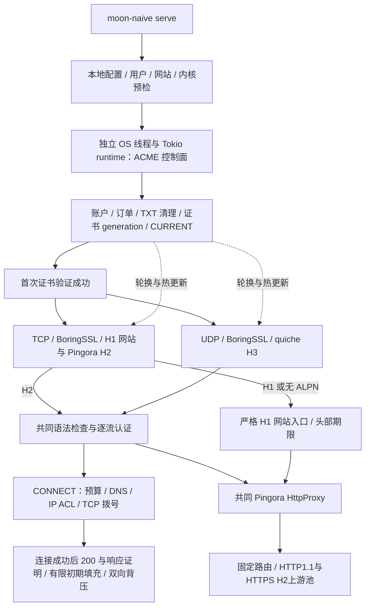

# 服务端架构

0.6.0 使用一个 Cargo workspace、一个 Cargo.lock、一个运行程序 `moon-naive`。根包直接构建 src/main.rs 与 src/lib.rs；core 是纯协议/配置逻辑，xtask 是构建工具。原 native 和 control 包已合入主服务端，只有一份 Cargo.lock。

## 生命周期

`src/runtime.rs` 先加载用户与网站，避免配置错误时先创建 CA 订单。证书管理器在专用线程创建自己的 runtime，账户、DNS、journal 和 fsync 不占用数据面工作线程。无有效证书时业务端口保持未绑定，按持久化退避等待签发；证书就绪后同时绑定 TCP/UDP，再发 systemd READY 通知。

续期失败保留仍有效的 generation；失效证书不能用于新握手。轮换先完整验证和持久化，再共同发布 H2/H3 TLS 上下文，已有连接继续。控制线程发生不可恢复错误或网络驱动退出时，主进程退出非零，服务管理器可重启并恢复状态。

SIGTERM/SIGINT 停止新连接/流、发送关闭信号并等待已有连接排空，随后限时清理本进程拥有的 DNS TXT。未完成操作的意图已经持久化，重启继续恢复。systemd 默认停止时限为 360 秒，对应默认连接排空 300 秒和控制面清理；修改排空时限后同步调整服务文件。

## 数据路径

代理只在TLS1.3 H2/H3上接受普通CONNECT及通用HTTP(S)请求，每条流重新计算HMAC证明。绑定来自真正的BoringSSL exporter和HTTP流ID，以及method/authority/scheme/path/protocol；没有全连接登录标志、时间窗口或nonce缓存。H2通过Pingora的只读stream_id接口取得实际编号；H3使用quiche事件编号。TLS1.2 H2仍可访问网站，但不建立代理认证上下文。

准入不依赖IP/User-Agent/TLS指纹判定请求者是不是探测器。语法合法但未授权的请求清理代理元数据后交给固定网站；任意目标DNS/拨号须通过本流认证。H2在轮询准入前优先观察已就绪的reset/连接错误，取消时丢弃等待中的准入及通道额度；H3保留传输层reset/STOP_SENDING检查和任务取消。普通END_STREAM/FIN是半关闭，不自动撤销有效请求。

固定网站WebSocket是公开网站能力，独立于代理认证。H2/H3扩展CONNECT先由site::websocket::prepare无I/O检查Host、版本、路径和固定上游，通过后才申请共享通道额度并连接源站。这样未知站点、无匹配路由和错误握手不会随隧道占用从404/400变成503；合法WebSocket和全局请求/连接仍受共同资源限制。Caddy源码对照及验证边界见[请求准入评审](NAIVE-REALITY-REVIEW.md#后续加固caddy-插件与请求准入)。

当前采用认证协商的8/16条初期窗口及可选稀疏后段；满载读块停止附加填充，不生成空闲假流量或修改真实反代内容。预算、线格式与客户端要求见[PROTOCOL.md](PROTOCOL.md)。

双向隧道共用原子活动时间戳：每次实际读写进展更新时间，计时器到原截止时间再检查是否需要延长，不逐块唤醒/重设计时器。时间戳使用单调时钟和 fetch_max，避免并发更新倒退；背压、半关闭及空闲时限含义不变。

H1 由同一网站引擎接管，入口检查原始报文，拒绝 CL/TE 歧义和受信字段的 Connection 指定删除；完整头部有 10 秒期限。直接调用 Pingora 会话时显式初始化并继承 H1 复用计数，第 1,000 次响应关闭连接。H2 协议错误 reset 次数有上限；H3 Retry 后仍未完成 TLS 的状态 10 秒内回收。既有流控和全局配额继续约束内存，未对正常隧道逐包额外扫描。

H2 网站请求直接进入完整 Pingora HttpProxy；H3 网站请求通过一个复用的有界内存 H2 连接进入同一引擎，没有额外公开端口。Naïve 隧道不经过该桥。内存管道 64 KiB，流级两格通道，独立流控窗口限制等待数据。

网站按配置中的最长字面前缀路由；origin 必须固定为 HTTP/HTTPS authority，不允许请求目标变为上游地址。池之间独立分组，HTTPS 校验证书及名称，支持自定义 CA/SNI/Host。保留多值 Cookie、流式正文与响应 trailers；代理字段、逐跳头和伪造转发头被清理。Range/HEAD/SSE/no-transform 不动态压缩。

## 与 Caddy + 作者插件

| 部分 | Caddy + forwardproxy | moon-naive |
| --- | --- | --- |
| 构建 | xcaddy / Go 与插件 | Cargo / Rust 与 BoringSSL C/C++ |
| TLS / QUIC | Go TLS / Go QUIC 栈及作者补丁 | BoringSSL / Cloudflare quiche |
| Naïve | 作者 CONNECT/认证/Padding | moon-naive exporter/HMAC绑定和有限初期记录；不再兼容原客户端 |
| 网站反代 | Caddy handler 链与插件生态 | Pingora HttpProxy、固定池/路由、gzip |
| 证书 | CertMagic 等成熟自动化 | 集成 instant-acme、Porkbun/GTS/EAB、持久恢复 |
| 管理 | 成熟产品功能丰富 | 单机单域名、静态 TOML、systemd/OpenRC |

当前不覆盖 Caddy 的全部插件/管理 API、多 SAN/通配符/按需证书、分布式锁或多 CA 自动切换。本地 Pingora 补丁补齐 H1/H2 请求/响应 trailers、H2 1xx 和升级连接读前缀；H3 桥转发中间响应和 trailers。固定网站路由支持 H1 Upgrade、H2/H3 WebSocket 扩展 CONNECT。补丁 baseline、文件清单及哈希在 vendor/pingora，发布时强制校验。指纹与性能结论见 [FINGERPRINTS.md](FINGERPRINTS.md)，不由组件名称推导。

## 统一配置与出站

schema v2 主 TOML 为 0600，统一包含用户、DNS/EAB、下一跳及网站规则。控制面使用 DNS/EAB，数据路径只使用代理/网站相关字段；同一进程持有共享配置，不宣称密钥在独立进程隔离。迁移工具保留源配置与持久状态，输出拒绝覆盖。

认证普通 HTTP 请求进入独立 Pingora 正向实例，用户/origin 为缓存键，最多 128 个实例；淘汰不取消已有请求。目标 DNS 结果受公网 ACL 限制，连接使用共享 Egress。可选 HTTP/HTTPS/SOCKS5 下一跳同样受拨号期限管理，连接失败不回退直连。HTTPS 下一跳与最终 HTTPS origin 是分别校验的两层 TLS。

普通 HTTPS 正向请求在同一应用实例中共享系统 CA 根：首次使用在阻塞线程读取/解析，后续只克隆共享引用，普通 HTTP 不加载根证书。失败不会缓存为成功；新应用实例重新加载，更新系统根后需重启。证书链和名称校验仍开启。此缓存不共享 TLS 会话或用户连接池，也不改变 ACME 网站证书热更新。

HTTP(S) 下一跳 CONNECT 响应以最多 2 KiB 的块读取，累计响应头仍限 32 KiB、最多八个响应块。头部边界后预读到的数据作为流前缀交给后续读取，保持顺序和半关闭；SOCKS5 消息边界和代理对外 Padding 不变。

H1 直接进入网站引擎；不会经过代理认证放行路径。未知 Host 为 404、站点 CONNECT 为 405，均有普通页面且无 Proxy-Authenticate。可选明文监听仅跳转规范域名。Alt-Svc 在网站出口生成，不污染一般正向 HTTP origin 的响应。

## 重构边界

根Cargo包直接构建服务端库和程序；core保持纯协议/配置逻辑，xtask负责验证发布。实际ACME、证书事务、网络与CLI统一在src，旧control/native包和旁路模型已移除。包名、二进制名、默认cargo build及-p moon-naive不变。

代理秘密头由 core::ingress::PROXY_HEADERS 统一定义；H1/H2/H3 网站、已认证正向请求和 WebSocket 共用规则。客户端转发身份头在网站入口清除，再按真实请求上下文生成允许的字段；trailers 额外清除消息分帧及路由字段。普通请求与升级协议仍保留不同处理流程。

网站生成的转发身份只用于管理员配置的固定源站。通用 HTTP(S) 正向代理在发送上游请求前清除已定义的 Forwarded/X-Forwarded-*/X-Real-IP 字段及 Via，避免向任意目标泄露客户端地址或代理链；普通应用字段仍正常转发。共用引擎尊重请求与响应中的 Cache-Control: no-transform，不额外动态压缩。设计依据与验证见 [NaïveProxy / REALITY 评审](NAIVE-REALITY-REVIEW.md)。

## 多站点连接、keepalive 与容量（2026-10-25）

网站数、HTTP 请求数、目标 TCP 连接数、CONNECT 流数和客户端到 VPS 的外层连接数是不同量。
普通 CONNECT 的一条流绑定一个目标 TCP 连接；浏览器可在这条目标连接内部再次复用 HTTP/2。
Naive 把多个 CONNECT 放进 Chromium 管理的少量外层 H2/TLS 或 H3/QUIC 会话，另有网站预请求。
H3 控制/QPACK 单向流不是目标 CONNECT；UDP 监听 socket 数也不等于 QUIC 连接数。

例如 80 个目标 TCP 连接，在健康外层会话及流额度足够时可以是 1 条外层连接、80 条 CONNECT、80 条出站 TCP。
这只是可行分配，非固定保证；会话轮换、并发分组、协议回退、流配额和重连可使新旧会话同时存在。
原客户端 insecure_concurrency 默认 1，不能据此断言任何时刻都恰好只有一个物理连接。

生产示例 max_streams=100：既用于每外层连接协议流上限，也用于全进程隧道预算（包括相关 WebSocket），
全局 H2/H3 请求预算为其两倍。max_connections=128 是共享连接预算，而非承诺能建立 128 个满窗口 H2/H3。
每外层 H2/H3 窗口预留=min(max_buffer_bytes_per_stream × max_streams, 16 MiB)。
示例 256 KiB ×100 经封顶为16 MiB，总64 MiB预算约允许4条此类外层连接。保留额度不等于已经分配同量RSS。
本轮修正：TCP 在 ALPN 确认 H2 后才预留窗口；H1 和 TLS 半握手不再误占 H2 窗口，仍受128连接预算及10秒TLS期限约束。

超过额度时可能拒绝连接、拒绝流或返回503；增加外层连接不能绕过全局100条隧道预算。
若实际经常超过100条目标连接，应一起评估 max_streams、max_total_receive_bytes、max_connections 和 VPS 文件描述符/内存，
不能只把 max_connections 调大。举例 max_streams=256 可提高全局隧道预算，但也改变每连接公布的流上限；当前示例未自动改大。

| 生命周期 | 当前服务端 |
| --- | --- |
| CONNECT 空闲 | 任一方向实际进展刷新共同期限，默认600秒静默后取消隧道、释放目标socket和预算 |
| CONNECT 活跃 | 不因达到某个固定连接年龄强行断开；半关闭保持另一方向继续传输 |
| H2 外层空闲 | 没有请求任务时等待空闲期限后退出；有任务时由请求/隧道自身期限约束 |
| H3 外层空闲 | quiche max_idle_timeout 与对端共同决定，通常取双方非零期限较小者；另有应用流空闲检查 |
| PING/传输保活 | 不等于隧道有效数据进展，不保证绕过应用层空闲回收；HTTP keepalive 也不等于定时发送心跳 |
| 网站源站连接池 | upstream_idle_secs 默认60秒；仅作用于可池化的网站/普通HTTP目标连接，不是CONNECT目标TCP的闲置缓存 |
| H1 网站连接 | keepalive空闲及请求头10秒约束，每连接最多1000请求；不是代理隧道 |

关闭后无法恢复原 TCP 字节流。浏览器/应用需要重新连接；Naive 可在尚存的外层会话开新CONNECT，或重新建立外层连接。
服务端重新认证/检查目标/拨号，成功后才200。不自动重放已经传出的应用数据；非幂等请求能否重试由应用决定。
TLS会话恢复不等于恢复旧目标TCP，也不意味着启用0-RTT。

原客户端（上游 d04efe1e）：桌面 idle_timeout=600s、tunnel_timeout=1800s；Android为300s/600s。
每分钟执行清理，依据连接最近写入时间，过期/旧NAK分组的空闲阈值缩为十分之一（桌面60s、Android30s），
并让 Chromium 关闭空闲会话。新连接触发分组到期轮换时换NAK；活跃旧流不因轮换立刻被切断。
这些是应用策略，不覆盖 Chromium H2/QUIC 自身期限、NAT超时、网络故障和GOAWAY。
原 forwardproxy（已补查至 `v2.11.7-naive2` / e747854e）普通HTTP Transport 的 IdleConnTimeout=60s、默认 MaxIdleConns=50；
CONNECT 双向复制没有同样的60秒池回收。最新修复在认证H2/H3 CONNECT上覆盖Caddy的读取空闲期限为24小时，避免read_body_idle提前断流，硬期限仍有效；它不等于本项目的双向进展600秒期限。实际关闭还由客户端/Caddy/目标/网络共同决定。

当前采用认证协商的8/16条初期窗口及可选稀疏后段；满载读块停止附加填充，不生成空闲假流量或修改真实反代内容。预算、线格式与客户端要求见[PROTOCOL.md](PROTOCOL.md)。

## RC4 Rust 网络栈与边界

| 组件 | 本项目中的用途与选择 |
| --- | --- |
| Tokio / Mio | 异步 TCP/UDP、任务调度、有界通道与取消；H3 仍由单个驱动拥有 quiche 状态，避免并发访问连接状态 |
| bytes | BytesMut直接读入、原地补零后freeze为Bytes；流控和有界队列保留所有权，避免整块payload复制。 |
| h2 / Pingora | HPACK、H2 流控、逐流认证后的分流、背压、反代连接池与流式高级协议；不自行重写 HPACK |
| quiche | Rust QUIC/H3、QPACK、BBRv2；继续使用 BoringSSL 提供握手与 ECH，不再引入 Quinn/Rustls 第二条实现路径 |
| Hyper / http-body-util / http | 控制面 HTTPS 和有界 HTTP 正文，以及统一 URI/首部类型；不增加第二个公开 HTTP 服务框架 |
| Hickory-proto | DNS 报文、权威查询和截断回退；系统目标解析仍通过 Tokio，未擅自替换系统 DNS 策略 |
| socket2 | 安全封装系统 socket 操作和 TCP BBR 检查；拥塞算法仍由 VPS 内核提供 |
| flate2 / miniz_oxide | Rust gzip，移除 zlib-ng C 后端；未使用的本地 Brotli/Zstandard 编码器不构建，源站已编码响应透传 |
| tar / goblin | 仅构建工具使用：Rust 归档与 ELF 静态链接检查，不进入服务端网络路径 |

RC4建立的共享拥有型缓冲保留；moon-naive在其上使用连接绑定认证和有限初期framing。H3驱动仍复用一个接收缓冲，成功读取后只移交有效部分；有界通道仍为两格，部分发送持有同一个Bytes。

这减少应用层 payload 复制，不是内核零拷贝；TLS/QUIC、gzip 和网络协议仍会复制或加密。Rust gzip 的 CPU 开销及压缩后字节可能与 zlib-ng 不同，未测得端到端吞吐或抗识别提升。原生编码的源站响应不重新编码；大文件、SSE、Range/no-transform 的既有处理继续保留。

Pingora 的对象缓存接口与其反代内部结构耦合，当前没有启用缓存。其 Zstandard 头部持久化后端改为可选，未启用时明确报错；没有伪造一个与原格式不兼容的新存储编码。系统服务文件、TOML、Dockerfile、公开测试证书及许可证保留各自标准格式；把它们改为 Rust 不会改善流量或运行效率。BoringSSL 仍包含 C/C++，socket/系统 DNS 仍依赖操作系统接口，因此不宣称整个二进制是纯 Rust。

暂不采用 io_uring/monoio/glommio：当前 Pingora、Tokio 和 TLS 接口需要运行时适配，增加复杂度，尚无基准证明值得切换。tokio-util/Tower 可用于特定标准协议或服务治理，但当前有限记录解析和已有 Pingora 限额不需要再叠加框架。MASQUE/WebTransport、任意插件、静态文件和无认证代理入口不属于当前服务目标。

smoltcp 适合嵌入式或用户态网络栈，不用于替换本服务的 Linux TCP：那会绕开现有内核 BBR 路径。Axum/Tower 可用于独立管理 API，但本服务不新增管理端口或第二套公开路由。`rustls-pki-types` 仅为证书字节类型，不代表启用了 Rustls TLS 引擎。

## 0.6.0 BBR与QUIC发送调度

TCP策略在`congestion::listen`创建socket后、bind/listen前设置，使accept队列中的子连接也继承BBR；入站、代理拨号、网站回源仍检查各自的策略。程序保留系统管理的TCP缓冲，不修改主机sysctl/qdisc。`check-transport`把配置选择和新socket读回的实际算法分开报告，并列出H2/H3窗口与接收预算。

Linux QUIC驱动使用一只非阻塞、CLOEXEC、CLOCK_MONOTONIC timerfd，通过Tokio AsyncFd等待quiche给出的发送时间。Tokio普通sleep为毫秒粒度，不能精确表达高带宽pacing的微秒级间隔。这里使用已锁定的rustix 1.1.5安全接口，不引入第一方unsafe、自旋、随机等待、额外填充或新的拥塞算法；非Linux仍走普通Tokio计时器回退，未做该平台性能验证。Tokio1.53.3弃用泛型安全注册接口；这里的具体OwnedFd私有持有且不允许替换/外部关闭，局部`expect(deprecated)`记录该所有权约束，保留workspace的unsafe禁令；升级Tokio时应重新检查接口，不能将此例外复制到任意AsRawFd实现。

每连接最多保留一个已经由quiche生成的待发报文，遇到未来发送期限或WouldBlock时保留原字节与包号。UDP阻塞等待可写事件，替代固定1ms重试；每轮64包额度耗尽后让出任务并继续，不再依赖可能迟到的ACK/50ms维护定时器。回归覆盖取消后过期timerfd的重新设置、不得提前发送、阻塞重试不重新生成包及发送额度后的继续调度。认证、取消、半关闭、0-RTT关闭及内存额度沿用原实现。

TCP BBR与quiche BBRv2分别管理TCP和UDP上的QUIC路径。BBR的带宽/RTT模型与fq/内核pacing说明参考[Linux v6.12 tcp_bbr.c](https://github.com/torvalds/linux/blob/v6.12/net/ipv4/tcp_bbr.c)；它不是对当前VPS内核BBR版本的判定。QUIC遵循锁定的[quiche SendInfo](https://github.com/cloudflare/quiche/blob/925b225825e2188f8e58e359114150500557bf61/quiche/src/lib.rs)发送时间，未使用SO_TXTIME或UDP GSO。实际测试条件、收益及保留的指纹见[VERIFICATION.md](VERIFICATION.md)和[FINGERPRINTS.md](FINGERPRINTS.md)。

## 0.6.0 建连延迟与运行时指令集适配

这轮以代理建连、请求处理和转发等待为目标。固定`proxy.upstream`现在由`outbound::NextHop`持有已解析的authority、配置及可选TLS上下文；`Egress`通过Arc在各请求和正向实例间共享。构造在既有`Prepared::load`的阻塞预检线程上执行，CA读取/解析不会反复占用数据面工作线程。HTTP/SOCKS5不构建TLS；HTTPS每次仍创建新的SSL对象和完整握手，验证该连接的证书与名称，没有自动会话恢复、0-RTT、提前200或目标socket复用。

信任库的生命周期是应用配置实例。新实例重新读CA，旧实例不随路径内容变化悄悄换信任；更新根证书需重启。不存在跨配置全局TLS缓存，错误名称和不受信证书仍在各连接拒绝。实际网络回归覆盖同一上下文重复连接、移走CA文件后已准备实例继续工作、新实例缺失CA失败、错误名称与不同CA拒绝，以及首段隧道字节保留。

共享头部验证将三次NUL/CR/LF查找合成一次memchr3；下一跳HTTP响应解析用预构造的memmem::Finder扫描每轮新收到的数据及3字节重叠。保留32KiB总头限制、最多8个响应块、分片边界和预读payload。memchr是锁文件已存在的2.8.3，这次增加直接依赖；没有更新其他第三方版本或vendor。第一方仍禁止unsafe。

CPU适配交给这些库的运行时分派：memchr支持AVX2/SSE2/通用实现；原有sha2 0.10.9在x86检查SHA、SSE2、SSSE3和SSE4.1；BoringSSL结合CPUID和OS扩展状态选择可用实现。新增的本地诊断只展示硬件能力与库，不改变协商协议、响应头或填充。默认Release仍为opt-level=3，没有通过全局native/AVX-512编译牺牲旧CPU可运行性。

本轮实际阅读和采用的依据如下；学习设计及调用公开API，没有将这些CLI工具或其源码复制进服务端：

| 参考源码（固定快照） | 应用方式 |
| --- | --- |
| [eza file.rs：OnceLock元数据](https://github.com/eza-community/eza/blob/471bfbc7b03cbac8c738e8d9050edb06ee79132a/src/fs/file.rs) | 把可复用且有明确生命周期的数据准备一次，避免每条请求重复文件操作。下一跳上下文限定在配置实例。 |
| [fd dir_entry.rs：按需缓存metadata](https://github.com/sharkdp/fd/blob/cc4e40fa4e32d61733cd72926e233a3fb6c8d56d/src/dir_entry.rs)、[main.rs：搜索前构造matcher](https://github.com/sharkdp/fd/blob/cc4e40fa4e32d61733cd72926e233a3fb6c8d56d/src/main.rs) | 将配置解析、TLS准备和固定分隔符匹配器移出重复处理环节；只在配置HTTPS下一跳时准备TLS。 |
| [ripgrep line_buffer.rs：只扫描新增字节](https://github.com/BurntSushi/ripgrep/blob/91f5d22ef48bde459d90a8c7dbeab416e97d0f2b/crates/searcher/src/line_buffer.rs) | 保留现有增量扫描边界，采用专门的字节搜索；不反复从响应头起点扫描。 |
| [memchr x86分派](https://github.com/BurntSushi/memchr/blob/bd6068c30e9074a90c285e47912fa0b047d07597/src/arch/x86_64/memchr.rs)、[memmem预构造searcher](https://github.com/BurntSushi/memchr/blob/bd6068c30e9074a90c285e47912fa0b047d07597/src/memmem/searcher.rs) | 使用安全API及库的AVX2/SSE2选择和小输入路径，不手写intrinsics或额外unsafe。构建使用Cargo.lock中的2.8.3。 |
| [sha2 0.10.9硬件/软件分流](https://github.com/RustCrypto/hashes/blob/sha2-v0.10.9/sha2/src/sha256.rs)及本地boring-sys 5.2.0的cpu_intel.cc | 核实已有密码加速能力，保留检测与软件回退。没有把已有SHA-NI/AES支持计成本次新实现。 |

保留原来的最多两个并发候选地址拨号与250ms交错策略。在初次配对基准中，单地址跳过JoinSet的候选实现从14.12μs变为17.42μs，因此撤回；不能由“少一个任务”直接推导延迟下降。最终源码和复测数据见[VERIFICATION.md](VERIFICATION.md)。

## 有限初期填充与切片优化（0.2.0-dev.4）

当前采用认证协商的8/16条初期窗口及可选稀疏后段；满载读块停止附加填充，不生成空闲假流量或修改真实反代内容。预算、线格式与客户端要求见[PROTOCOL.md](PROTOCOL.md)。

无Go网络栈进入服务端。构建检查拒绝Go源文件/模块，依赖审计拒绝Caddy等包名，发布ELF检查常见Go元数据；外部Pebble测试工具与原项目研究源码不属于运行包。协议、参考源码和具体预算见[PROTOCOL.md](PROTOCOL.md)。

## 2026-11-04：长连接与依赖安全增量

H3驱动不再每50ms扫描所有连接。下一次唤醒取QUIC超时、pacing、未完成握手期限、活动流的应用空闲期限及排空期限中的最早值；UDP读写就绪和桥接任务的Notify仍立即唤醒。每轮发送64包、处理128个H3事件的公平性额度保留，额度耗尽主动让出后继续，不等待下一次网络事件。没有加入空闲保活包，也没有加大窗口/缓冲或放宽认证前的10秒握手回收。

quiche路径事件每轮最多消费64个，超过时继续调度，避免长期保留已经交付的事件。实际路径验证仍由quiche负责；网站请求的来源地址取当前active路径。固定quiche提交已包含失败路径插入不产生无限事件的上游防护，本改动是集成层的事件消费，不宣称自行修复其旧CVE。

**路径限制仍存在**：目前只路由一个服务端CID、禁用主动迁移。回归验证一次NAT源端口变化后继续复用；实验发现连续第二次端口变化会超时。完整支持需实现额外CID的路由、轮换、退役和路径资源回收，不能只扩大路径容量。客户端遇到此情况需重建连接；本版不承诺任意次数NAT重绑定。

`Activity`按最后一次实际数据进展计算期限；虚拟时间测试推进24小时验证活动延长期限、随后真正空闲仍到期。这不是24小时真实网络运行。默认600秒是应用空闲期限，连接可以持续更久，但始终受连接/流/接收预算约束。

依赖将hickory-proto从0.25.2更新至0.26.1、time从0.3.44更新至0.3.47，Cargo.lock同步有限传递更新；未启用DNSSEC或新增另一套TLS栈。权威TXT查询先验证UDP事务ID、Query opcode和完整问题，再允许TC触发TCP回退；TCP结果重新检查事务、无截断、NoError、AA、IN类及目标TXT。继续限制单个查询、65535字节缓冲和总5秒期限。错误UDP响应不再触发额外TCP连接。

Linux内核版本诊断仅使用本地只读osrelease和公告中的分支参照，不运行命令、不联网、不修改内核或防火墙。发行版回补状态不由版本字符串证明；CVE-2026-98432在应用accept之前，必须单独修复宿主内核。公告适用性和依赖扫描的保留项见VERIFICATION.md。
