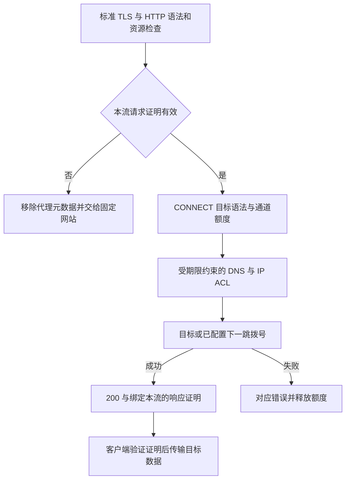

# NaïveProxy、REALITY 对照与本轮加固

审阅日期：2026-11-02。moon-naive 版本保持 0.2.0-dev.4、协议修订4。本报告接续 [AnyTLS 评审](ANYTLS-REVIEW.md)，不代表完整安全审计或实际审查系统识别率测试。

前半部分记录正向身份字段和压缩修正；末节记录随后完成的 Caddy 插件入口对照、请求准入和取消处理。各阶段的验证结果分别记录。

本次参考的源码快照：

- [NaïveProxy README](https://github.com/klzgrad/naiveproxy/blob/6acbded5dc48d0c5abcb08364c6bcdbf451329b1/README.md)：`6acbded5dc48d0c5abcb08364c6bcdbf451329b1`。
- [REALITY README](https://github.com/XTLS/REALITY/blob/83f621788ca88b83179810b12baa7ae518aacb83/README.en.md)、[TLS 入口](https://github.com/XTLS/REALITY/blob/83f621788ca88b83179810b12baa7ae518aacb83/tls.go)、[记录探测](https://github.com/XTLS/REALITY/blob/83f621788ca88b83179810b12baa7ae518aacb83/record_detect.go)：`83f621788ca88b83179810b12baa7ae518aacb83`。

Issue/PR 的状态是审阅时状态，后续上游可能继续修复。社区作者的实验数字不等于本项目独立复现的结果。

## 应当继承的 NaïveProxy 思路

NaïveProxy 的关键是复用真正的 Chromium 客户端网络栈、标准 TLS 和 HTTP/2、HTTP/3 CONNECT，把代理认证放在正常 TLS 建立后的 HTTP 层，同时提供真实的网站服务。复用、流控、连接生命周期和错误处理也是这一思路的一部分，不能只复制 ClientHello 或 padding。

moon-naive 保持真实自有域名证书与 ACME 生命周期；TCP 入口使用 BoringSSL，H2 由 Pingora/h2 处理，H3 由 quiche 处理。每条请求在应用层认证，再进入 CONNECT、HTTP(S) 正向代理或固定网站反代。认证失败与普通访问共用网站引擎，不返回代理认证挑战。成功 CONNECT 必须先拨通目标，再返回 200 和响应证明。

因此，本项目不需要采用 REALITY 的 Session ID 认证、目标站 TLS 转发与本地 TLS 之间的认证分支，也不需要模拟目标站的握手后记录。它避免的是这些机制带来的特定依赖和一致性负担；正常网站与隧道在流量分布上仍然不同。

**服务端用了 BoringSSL，不等于客户端拥有 Chromium 网络栈，也不等于服务端与 Chrome 相同。** 本项目的修订4认证与官方 NaïveProxy 不兼容；真正的新 Chromium 客户端尚未交付。不能以合成客户端回归通过宣称官方客户端互通。

## REALITY 社区报告与适用范围

| 来源 | 核实结果、状态及限制 | 对 moon-naive 的启示 |
| --- | --- | --- |
| [net4people #481：Aparecium](https://github.com/net4people/bbs/issues/481) | 历史报告讨论握手后消息（例如 NewSessionTicket）差异。报告中的识别率依赖其版本和实验条件；未在本轮独立复现。 | 不仿造远端站点的 ticket/记录数量和长度。由同一 TLS 实现处理本协议入口，避免维护另一份远端行为模型。 |
| [net4people #576](https://github.com/net4people/bbs/issues/576)、[REALITY #29](https://github.com/XTLS/REALITY/pull/29) | 社区讨论重放/不推进握手的记录，以及本地与转发 TLS 对异常输入的差异。#29 已合并自适应 CCS 限制检测，不能把旧的固定阈值问题直接写成当前未修漏洞。 | 不把认证结果用于选择两套 TLS 状态机；不将某个 CCS 阈值硬编码成所谓通用修复。标准栈仍须跟进异常记录处理与资源限制。 |
| [REALITY #36](https://github.com/XTLS/REALITY/pull/36) | 已合并探测代码的截断记录切片 panic、连接清理和数据竞争修复。它们是应学习的历史缺陷，不是本次快照中仍存在的同一漏洞。 | 尽量不建立独立 TLS 探测/解析器；保留 Rust 所有权、有界队列与取消回归。Rust 本身不能证明没有逻辑竞态或资源泄漏。 |
| [REALITY #43](https://github.com/XTLS/REALITY/pull/43) | 审阅时仍开放，提出给校准握手增加 10 秒期限。固定源码的校准 `uConn.Handshake()` 没有显式期限，TLS 入口有等待记录缓存的循环。未运行报告复现，不能把所有资源泄漏声称视为已证实。 | moon-naive 没有此校准缓存或等待目标特征的循环。固定网站回源失败仍会影响网站响应，但已准备好的 TLS 证书/握手不以远端校准成功为前提。现有握手、回源及空闲期限继续保留。 |
| [REALITY #31](https://github.com/XTLS/REALITY/pull/31) | 重放缓存提案已关闭、未合并；讨论包含无法在当时新版复现及 CDN/WAF 误报问题。不能据此声称当前存在已验证的认证绕过。 | 本项目保留 TLS exporter、实际流 ID、请求字段绑定的 HMAC 和响应证明，不移植时间窗口或全局重放缓存。泄露秘密和弱口令仍是独立风险。 |
| [Xray-core #6714](https://github.com/XTLS/Xray-core/issues/6714) | v26.7.28 的报告涉及随机 uTLS 模板宣告 MLKEM 组后，对相应 HelloRetryRequest 的支持不一致；关闭为 not planned。它不是所有 REALITY 客户端或所有当前版本的共同结论。 | 宣告的能力必须由实际状态机实现；新客户端应使用完整 Chromium 栈，而不是手工拼接“像 Chrome”的指纹模板。服务端修改不能替代这项客户端工作。 |
| REALITY 固定 README 与 TLS 源码 | 上游本身提示 fallback 限速可能形成模式；TLS 入口在完整认证前连接配置目标，并有目标记录长度探测/模拟路径。 | 不引入按认证成败切换的外部 TLS 转发与校准依赖，不新增针对未认证分支的特制限速模式。正常资源保护仍然必要，且也可能产生可观察行为。 |

NaïveProxy 同样不能被当作“已证明无特征”的基准。[NaïveProxy #824](https://github.com/klzgrad/naiveproxy/issues/824) 未公开足以复现的完整分析方法；维护者说明其用于排查的新指标当时无需行动。不能补写未披露的攻击细节，也不能声称本轮已修复该报告。

## 本次在 moon-naive 中实际修正的两处行为

### 正向代理不再向任意目标透露转发身份

`src/net/site/mod.rs` 的共用请求入口会生成网站回源用的 `X-Forwarded-For/Host/Proto`。原正向代理路径也继承了这些字段，并可能透传 `Via`，与 NaïveProxy 示例中的 `hide_ip`、`hide_via` 隐私取向不一致。

现在正向请求在发往 HTTP/HTTPS 目标之前移除已定义的转发身份字段及 `Via`，同时使用已有的大小写/下划线规范化规则处理字段名。固定网站仍可向管理员配置的受信源站发送正常转发元数据。普通应用字段、目标 Host、请求正文和既有证书/ACL 检查保留。

本轮先增强网络断言，再修改实现：修复前本地目标实际收到合成的 `X-Forwarded-For: 127.0.0.1` 及测试 `Via`，测试失败；修复后 H2/H3 HTTP 正向与 HTTPS 正向检查通过。该实验验证本地客户端地址泄露路径，没有声称测量过公网真实地址。移除这些字段也不能隐藏应用主动放入 Cookie、URL 或正文中的身份。

### 尊重请求中的 no-transform

原来响应含 `Cache-Control: no-transform` 会禁止动态压缩，但请求表达同一意愿时仍可能 gzip。现在共用网站引擎同时检查请求与响应，支持多个字段和大小写不同的指令；请求含该指令时不再主动进行 gzip 变换，源站已有编码按既有路径透传。

[RFC 9111 §5.2.1.6](https://www.rfc-editor.org/rfc/rfc9111.html#section-5.2.1.6) 把请求指令定义为客户端向中间节点提出的偏好；[§5.2.2.6](https://www.rfc-editor.org/rfc/rfc9111.html#section-5.2.2.6) 对响应指令使用 MUST NOT。这里选择尊重前者，不把它误写成与后者完全相同的强制要求。

修复前新增断言在 H2 路径失败；修复后 H2/H3 均无额外 Content-Encoding 且正文一致。原有正常 gzip、响应 no-transform、Range/HEAD/SSE 等回归继续保留。这是减少非必要内容变换的语义改进，不是 TLS 指纹消除算法。

两处修改均是本项目中独立发现的问题，并非声称移植了 REALITY 的漏洞修复。未修改协议线格式、认证、填充参数、依赖锁或 vendor。

## 继续保留的设计边界

- 使用真实证书及证书校验；不借用无权控制的站点身份，不模拟远端握手后记录。
- 保留每流响应证明和目标拨号成功后才返回 200 的规则；不为缩短包长削弱 HMAC。
- 保留逐方向、逐流 8/16 条初期有限填充与可选稀疏后段；不加固定周期空闲假流量或全程大量填充。
- 不启用 Fast Open、0-RTT 或旧协议降级；保留 H2/QUIC 标准复用和背压。
- 不以删除错误处理或资源限制来掩盖异常流量；固定网站应保持真实、稳定、可用的内容和回源行为。

## 验证及仍未解决的测量问题

本轮使用 Rust 1.89.0、GNU/Linux Debug 构建：

- `cargo test --workspace --locked`：**123 passed / 0 failed / 8 ignored**，其中主库90、CLI2、core29、xtask2。外部集成、抓包和微基准等 ignored 项没有计为通过。
- `cargo clippy --workspace --all-targets --locked -- -D warnings`、`cargo fmt --all --check`、`git diff --check` 均通过。
- 两项新增网络断言先在旧实现中失败，再随修复通过；增强的是现有集成测试，因此总测试数没有增加。网站可信回源元数据、正常 gzip、源站 no-transform、HTTPS 名称/信任校验等既有回归同时通过。

复现日志留在工作区 `reports/reality-review/`，不随源码包交付。

仍需真实 Chromium 修订4客户端、真实 RTT/丢包和长期负载，以及包含普通浏览器对照的抓包实验。H2 SETTINGS/流控、QUIC 参数、证书/ALPN、CONNECT 长连接与内层 TLS 的长度、方向和时序关联仍可能被观察。本轮没有新的公网 DPI 识别率、吞吐基准、24 小时稳定性、公网 ACME 或 Release/musl 验收；不能把历史报告当成本轮重跑结果。

本轮落实的是减少身份泄露、忠实转发内容，以及避免引入特定的双 TLS 分支/校准机制。它不证明 moon-naive 无流量特征，也不证明当前 REALITY 普遍可识别。

## 后续加固：Caddy 插件与请求准入

继续审阅日期：2026-11-02。参考的是 NaïveProxy 作者维护的 `klzgrad/forwardproxy` 的 `naive` 分支，固定提交 [`e747854e78743dba85c039b38ed185fb11d93667`](https://github.com/klzgrad/forwardproxy/commit/e747854e78743dba85c039b38ed185fb11d93667)。依据为 [forwardproxy.go](https://github.com/klzgrad/forwardproxy/blob/e747854e78743dba85c039b38ed185fb11d93667/forwardproxy.go) 和 [README](https://github.com/klzgrad/forwardproxy/blob/e747854e78743dba85c039b38ed185fb11d93667/README.md)。这次是源码对照和 moon-naive 本地回归，没有运行 Caddy 对照抓包。

### 服务端应该识别什么

服务端能验证当前请求是否获得代理授权，不能可靠判断一个陌生请求背后是不是主动探测器。浏览器特征、IP、User-Agent、TLS 指纹、访问路径或访问节奏均不能替代凭据；QUIC Retry 只验证地址，不认证代理用户。持有有效秘密的一方仍能建立授权请求，认证不提供其动机保证。

因此沿用 Caddy 的 handler 分流思路：TLS/HTTP 栈按正常服务器语义接入，代理逐请求认证，未授权请求交给普通网站。不是给“疑似 DPI”单独返回假页面、故意静默或固定延迟。网站也不因收到 CONNECT 就把目标当成反代源站。

| Caddy 作者插件的实际行为 | moon-naive 的取舍 |
| --- | --- |
| `ServeHTTP` 在启用 `probe_resistance` 时将缺失/错误认证交给 `next.ServeHTTP`；本站非 CONNECT 也交给后续网站 handler。没有启用该选项的其他未认证代理请求可得到 407。 | 固定保留共同网站分支；不需要再打开一个 TOML 抗探测开关。正常网站处理可以产生 404/405，不能保证所有输入都得到 200。 |
| 可配置 secret domain 触发认证页面，PAC 文件也可能提供代理线索；这些不是所有安装都自动启用。 | 不新增秘密登录域名、挑战页面或 PAC 入口；客户端主动携带逐流证明。 |
| `checkCredentials` 使用 Basic，比较循环找到用户后返回；源码明确说明整体并非 timing-attack-safe。 | 保留现有 exporter/流 ID/请求字段绑定的 HMAC；格式合法时检查所有用户键，不因匹配用户位置提前退出。解析、网站回源和整个响应过程仍不是恒定时间，不能把常数时间 MAC 比较写成完整时序不可区分。 |
| CONNECT 在目标 ACL/拨号前发送并 Flush 200，即源码称的 HTTP CONNECT Fast Open。 | 保持既定的先拨号后 200 与响应证明，避免把拨号失败当成已建立通道；此顺序仍会影响响应时序。 |
| 此提交修复 `read_body_idle` 影响授权 CONNECT：只对该 H2/H3 CONNECT 请求覆盖读取空闲期限为 24 小时，硬期限仍有效。 | 网站期限与代理隧道期限分别适用；隧道任一方向实际进展刷新共同空闲期限，默认600秒。无需把所有网站请求放宽到24小时，普通 FIN仍为半关闭。 |

### 准入顺序与这次修正

普通代理 CONNECT 的有效顺序保持为：

接入过程会保留连接/请求预算和有限的早期 DATA 流控窗口；它们不等同于任意目标拨号权限。目标数据在准入完成前不转发。收到取消后停止未完成的准入并释放持有的资源；已经发出的网络报文或已提交给系统的 DNS 操作无法撤回。

**修正一：先验证固定网站 WebSocket，再申请通道额度。** 原 `App::prepare` 在检查网站 Host、WebSocket 版本和路由之前申请共享 tunnel 额度。实测未知 Host 的扩展 CONNECT 在空闲时为404，额度耗尽后变成503；外部请求可以据此观察内部额度状态。它不是已证明的代理专有指纹，但属于可避免的行为差异。

现在 `site::websocket::prepare` 完成无 I/O 的 Host、版本、路径、固定上游检查，返回字段私有的 `Prepared`；只有通过检查的请求才进入额度申请和 `connect`。不匹配的网站请求保持其404/400；合法网站 WebSocket仍能连接管理员固定上游，并受相同总预算及握手期限约束。没有增加运行配置或新的代理入口。

真实 H2/H3 回归分别在额度空闲/全部占用时，发送未知 Host、未匹配路径、错误 WebSocket 版本，并覆盖无凭据与错误 Basic 凭据。旧实现首先在 H2 的503/404断言失败；修正后两种传输的状态和正文均保持一致，无代理认证挑战/证明/Padding字段、无代理 DNS 或拨号。该测试不比较响应时间，也不保证合法 WebSocket或全局连接/请求预算耗尽时不可观察负载。

**修正二：H2 优先处理已就绪的取消信号。** 原 `tokio::select!` 对准入和 reset 随机决定先轮询哪个分支。在 reset 已可见时，仍可能先开始准入。现在 `admit_until_closed` 先检查会话的 reset/连接错误，再轮询准入；取消会丢弃未完成准入及其持有的额度。没有提前读取请求 DATA、增加接收信用或把普通 END_STREAM 当作取消。

新增两个确定性生命周期测试，分别证明已经关闭的流不启动准入副作用，以及取消等待中的准入会归还额度。已有真实 H2/H3 延迟准入、带早期 DATA 的 reset、H3 STOP_SENDING 和正常 FIN 回归继续保留。H3 已有传输层关闭检查及任务取消机制，这次没有为了代码对称改写其驱动。

同时增强同连接逐流认证测试：在合法隧道之后发送缺失、错误 Basic、格式正确但 MAC 伪造、重复及下划线别名凭据。H2/H3 都必须回到普通错误响应，各自与无认证基线的首部和正文一致（排除随时间变化的 Date），没有额外任意目标拨号；不能继承先前流的授权。原有跨流、跨连接和跨传输证明重放拒绝继续验证。

### 客户端与残余特征

客户端应使用完整 Chromium 网络栈，正确生成每个真实流的证明，对认证字段采用 never-index，并在证书及成功响应证明验证完成后才发送目标数据。复用、流控、证书校验、回退和取消也必须由实际实现支持；只更换 ClientHello 模板不足以实现 NaïveProxy 的思路。本轮未交付该客户端，官方 NaïveProxy 客户端仍不兼容修订4。

服务端继续提供真实固定网站、标准协议和既有限额，不按“像不像浏览器”切换 TLS 实现。它不能消除目的 IP、SNI/ALPN、H2 SETTINGS、QUIC 参数、长连接方向和时序，以及内层 TLS 的相关性。认证解析成本、共同 CPU/连接/请求/通道预算也可能留下可测差异；这次消除的是明确复现的无效 WebSocket准入顺序问题，未证明所有失败请求在任何负载下都不可区分。测试范围和最终计数见 [VERIFICATION.md](VERIFICATION.md)。
