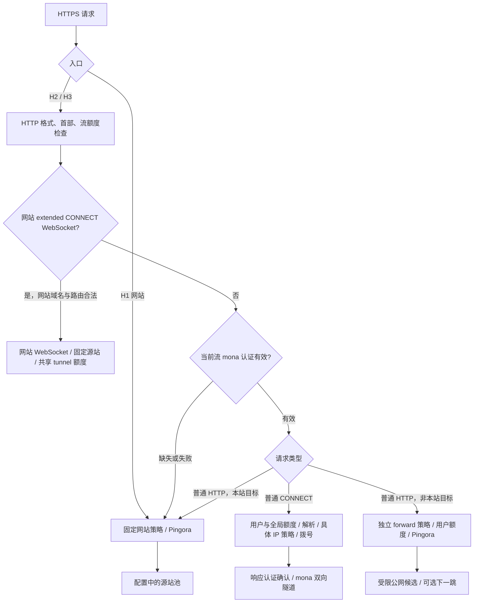

# moon-naive 项目手册

0.7.0，Linux x86_64 服务端。canonical 协议名 **moon-naive**，简称 **mona**；
只实现修订 4，不兼容官方 NaiveProxy。生产客户端留待后续，导入的 Chromium/Android
客户端仍属实验。协议字段与 framing 的唯一权威是 [协议规范](PROTOCOL.md)，
配置字段与默认值以 [单端口示例](../config.example.toml)、
[双端口示例](../config.dual.example.toml) 和配置校验为准。

- [运行与配置](#运行与配置)
- [组件与路由](#组件与路由)
- [证书、健康与恢复](#证书健康与恢复)
- [构建、验证和实验](#构建验证和实验)
- [发布与许可证](#发布与许可证)
- [维护与验证记录](#维护与验证记录)

## 运行与配置

构建需要 Rust 1.100+（验证使用 1.100）、C/C++、make、CMake、libclang、Perl、
pkg-config、Git 和系统 CA。BoringSSL 使用原生工具链；普通构建不需要 Go 或 Python 实验依赖。

```sh
cargo build --release --locked -p moon-naive
moon-naive config init /etc/moon-naive/config.toml
moon-naive check-config /etc/moon-naive/config.toml
moon-naive check /etc/moon-naive/config.toml
moon-naive serve /etc/moon-naive/config.toml
```

先创建由服务用户所有的父目录。init 创建 0600 私有配置并拒绝覆盖；填写真实域名、
高熵用户密码、固定网站 origin、DNS 凭据与 CA 联系方式，阅读条款后明确设置
`accept_terms=true`。state_dir 默认 `/var/lib/moon-naive`，权限 0700，必须持久保存。
`check-config` 做结构校验；`check` 做本地预检，不申请证书、不改 DNS、不启动监听器。
`serve` 取得并验证首张证书后监听 TCP/UDP 443，随后自动续期。

域名 A/AAAA 必须指向实际可达地址；不可达 IPv6 不应发布 AAAA。源站不要指回本站，
NAT/无法从接口推导的本机公网地址应显式配置以防自反代。DNS-01 无需开放 80；程序
只管理挑战 TXT，不替操作者管理 A/AAAA、NS 或 CAA。

### 多端口与资源边界

旧 schema 1/2 的 `[listener]`、`[limits]` 配置继续有效，默认仍为 TCP/UDP 443。
显式多端口使用 `[[listeners]]` 数组，也可只定义一项。数组存在时完全替代旧 `[listener]`
（包括旧表的 public_addresses）；迁移时把需要的字段移到端点，不要保留相互冲突的两套配置。
每项有唯一 ASCII `name`，最多 16 项，分别指定 `tcp`、`udp`、`h1`、`h2`、`h3`。
禁用某协议就不绑定对应传输；H1 仅提供网站，不接受通用代理认证。
IPv6 写作 `"[::]:443"`，IPv6 socket 明确 v6-only；要同时服务 IPv4/IPv6，添加两个
不同名称、不同地址族的端点。确切重复、同族 wildcard 重叠及实际占用的端口不能启动。
所有 socket 绑定成功后才进入服务；部分失败不会留下可用但配置不完整的监听器。

完整可解析示例分别见上面两个文件。双端口示例保留 443，另开 8443，同一进程管理一份
用户、ACME/DNS 状态和证书，复用网站及下一跳连接池。没有跨端口负载均衡，也不按来源
IP 限制一个用户的设备数。为降低风险，先运行 `check-config` 和 `check`，再重启切换；
监听地址、ACL、额度变更均需要重启，证书/ECH 热加载机制继续工作。

| 配置 | 含义 |
| --- | --- |
| 顶层 `[limits]` | 全进程连接、H2/H3 流/待处理请求、隧道、用户及字节安全上限 |
| `[listeners.limits]` | 端点本地额度及 connect/idle/graceful timeout；仍受全局限制 |
| `listeners.handshake_timeout_secs` | 入站握手期限，默认 10 秒 |
| `[listeners.flow]` | 独立 `h2_stream_window`、`h2_connection_window`、`h3_stream_window`、`h3_connection_window`，单位字节 |
| `listeners.public_addresses` | 本端口使用的公网/NAT 地址；所有端点地址共同进入强制自连接拒绝集合 |

省略整个端点 limits 表时继承顶层值；出现该表时，未写字段使用 `Limits` 的标准默认值，
而不是逐字段合并顶层。建议按完整双端口示例显式填写重要额度。省略窗口字段时按端点额度
计算有界默认值。H2 连接窗口不能小于 65535；H3 为控制/QPACK 留出预算，要求流窗口与
最大流数量的乘积加保留额不超过连接窗口。提高窗口会占用不可提前归还的接收信用，
不是“提速开关”。应用缓冲池与传输信用分开计账；多个端口不能分别花掉同一份全局预算。
一个端口本地饱和不消耗其他端口的本地额度，但全局安全上限仍可能使所有端口拒绝新任务。
普通转发缓存仍按用户和 origin 在全局最多保留 128 个闲置源站条目，每条最多持有
16 个端点视图；视图复用底层连接池但使用端口自己的缓冲和超时。全局淘汰会同时
释放闲置视图，已进行的请求持有自己的池租约，结束后归还，不因淘汰中断。
`max_streams` 和待处理请求额度用于多路复用的 H2/H3；H1 不提供流多路复用，
每个连接同时至多一个网站请求，受全局/端点 `max_connections` 约束，不额外宣称
H1 有相同的流/排队额度。按网站并发需求同时配置连接数，不只修改 max_streams。

可选 `listeners.bandwidth_bytes_per_sec` 是端点级实际字节速率，不是窗口：上传和下载
各有一个桶，由该端点所有 TCP/UDP 会话共享，最多 16 KiB 初始/空闲突发；省略则不限速。
范围 1024..1000000000000 字节/秒。TCP 在 TLS 外层调度，握手和网站流量也计入；
QUIC 发送使用有界定时调度，入站超额数据报丢弃，由传输重传/背压恢复，不在 UDP
驱动内部睡眠。极低速率会延长握手及触发空闲期限，应与超时一起配置和测量。
这不是按 IP 的设备限制，也不承诺端口内部每个连接的公平份额。

每个端口的 Alt-Svc 必须指向该端口启用的 UDP/H3 端点；禁用 H3 时不广告它。
服务只能检查本地配置，无法证明公网防火墙、NAT 或运营商 UDP 路径可达。按每个端点实际
开放 TCP/UDP，不要把未映射的内部 UDP 端口暴露到公网广告中。QUIC active migration
保持禁用；不以实验性 CID 路由或迁移功能掩盖实现差异。

SIGTERM 停止所有端点接收新连接/流，按配置排空后释放资源；服务管理器停止期限应覆盖
最大的 graceful timeout 与控制面清理时间。部署单元仍是一个服务，无需数据库或控制面服务。

### 网站、正向代理与下一跳

- `[website].origin` 为单站简写，如 `http://127.0.0.1:8080`；只接受 scheme/主机/端口，
  不接受用户信息、子路径和 query。HTTPS 使用正确 SNI/链验证；不自动改写跳转或 Cookie。
- 多源站使用 `[[website.upstreams]]` 和 `[[website.routes]]`，与 origin 简写互斥。
  路由按最长 path_prefix 匹配；可设置 Host、TLS server name、私有 CA 和 H1/H2 上游。
  配置源站可用私网；访问域名不能临时指定源站。H1 网站默认启用，可按 listener 配置选择。
- 网站保持 WebSocket、流式响应、trailer、Range、SSE/gRPC 和 no-transform 语义。
  H1 framing/Host/Connection 字段严格检查，清除伪造的 forwarded/代理元数据。
- `[proxy.forward]` 独立于网站：默认上传上限 1 GiB、connect 10s、read/write 120s、
  idle pool 30s、每用户同时 32 个请求。旧配置仍可读，但正向代理不再继承网站 body/timeout。
- 普通网站默认上传上限 64 MiB、connect 5s、read/write 30s、upstream idle/DNS TTL 60s。
  这些是数据/连接期限，不要求全量 body 缓冲。重试限额按唯一客户端字节计数；
  已建立 CONNECT 不重放，非幂等且执行状态不确定的请求也不能透明重试。
- CONNECT、普通正向请求和网站 WebSocket 消耗共享额度；认证代理另有每用户限制。
  QUIC 接收信用与应用队列分开计账，已广告的连接信用不会随一条流结束提前归还。
- 出站只拨经过检查的具体解析候选：ASCII DNS 名、显式端口与 bracketed IPv6，
  拒绝私有、特殊、映射私有地址及自连接。配置的固定网站源站使用独立信任策略。
  HTTP/HTTPS/SOCKS5 下一跳保留各自认证/TLS 校验，失败不静默回退直连；
  不通过远端 DNS 绕过本地目标检查。

完整字段和默认值直接参照配置示例；下方仅保留可执行的局部路由示例。
`moon-naive check-transport CONFIG` 可查看实际传输窗口与参数。

### 文件目的地 ACL

在主配置添加：

```toml
[proxy]
acl_file = "/etc/moon-naive/acl.toml"
```

若已有 `[proxy]`，把字段加入原表，不要重复建表。文件必须为服务用户可读的私有 regular
file（0600），使用现有安全文件读取路径；拒绝最终组件符号链接、非私有权限、FIFO、
超大或无效内容。路径必须绝对且不含 `..`。上限 256 KiB、4096 条规则，每条最多 128
个端口范围；错误会阻止启动，不会回退为放行。父目录必须由可信管理员控制。
`check-config` 只解析主配置，不读取外部 ACL；`check` 会加载并验证全部外部策略。

[acl.example.toml](../acl.example.toml) 是完整文件示例。格式为 `default = "allow"` 或
`"deny"` 和有序 `[[rules]]`，配置文件省略 default 时为 deny。每条规则有必需的
`action = "allow"`/`"deny"`，以及零个或一个选择器：

| 选择器 | 匹配 |
| --- | --- |
| `domain = "example.org"` | 精确 ASCII DNS 名，大小写无关 |
| `suffix = "example.org"` | 域本身和标签边界内的子域，不匹配 notexample.org |
| `ip = "1.1.1.1"` | 具体 IPv4/IPv6 地址 |
| `cidr = "2606:4700::/32"` | 规范网络地址；拒绝带 host bits 的 CIDR |
| 无选择器 | 任何目标，可只限定端口 |

`ports = ["443", "8000-8080"]` 为可选的闭区间并集；省略或空数组匹配所有非零目标端口。
不支持通配符、Unicode 域名、尾随点或脚本；IDN 先转 punycode。IPv4-mapped IPv6
按 IPv4 规范化；mapped CIDR 前缀必须至少为 96。未知字段、反向范围、零端口均无效。

规则按文件顺序，第一个匹配“原始目标名 + 目标端口 + 本次具体 IP 候选”的规则决定结果，
未命中才用 default。按 CIDR 拒绝的规则应放在宽泛域名放行之前。DNS 前可确定的拒绝会
提前执行；涉及先前 IP 规则时延迟到解析候选后判定，避免改变 first-match 语义。
每次解析出的每个候选都再次检查；只能拨经验证的具体地址，下一跳 HTTP/HTTPS/SOCKS5
不能要求远端重新解析原域名来绕过检查。缓存的普通转发池也保留原目标身份及检查路径。
被配置的外部下一跳仍是管理信任边界：本地只能验证交给它的具体地址，不能证明其内部
路由、NAT 或转发实现遵守该地址；部署网络仍须限制敏感服务的可达性。

ACL 对认证 CONNECT 和普通 HTTP(S) 正向转发一致生效；所有端口共享同一不可变策略。
未认证流量仍不能访问任意目标。固定配置的网站源站使用独立的管理信任策略，不受代理
目的地 ACL 控制。强制的私网、特殊用途、本机接口、所有 listener 和显式公网/NAT 自地址
拒绝先于任何 allow，ACL 不能提供私网例外。未配置 ACL 时保留原有的公共目标 IP 策略，
并不等于关闭强制检查。当前不热加载 ACL；原子替换文件后重启，失败启动不激活残缺策略。

### 网站路由示例

用此块替换原 `[website]` 并删除 origin 简写，不能重复追加同名表；本例由 core 测试实际解析。

```toml
[website]
compression_level = 5
[[website.upstreams]]
name = "app"
origins = ["http://127.0.0.1:3000"]
http2 = true
[[website.routes]]
path_prefix = "/api/"
upstream = "app"
strip_prefix = true
```

`/api/users?limit=10` 转为 `/users?limit=10`，不匹配路径返回 404。

### 凭据与迁移

配置可内嵌用户、DNS/EAB 凭据，也可引用私有 TOML 文件；不要把填好密钥的配置提交 Git。
用户密码至少 16 字节，建议独立随机 32 字符以上。上游代理认证与入站 mona 认证是不同用途。
`config migrate OLD NEW` 输出兼容迁移文件，保留原件；私有读取拒绝符号链接最终组件、FIFO、
非私有文件与超大内容，父目录仍须由可信管理员控制。

GTS/Google Public CA 首次注册需要 EAB，Porkbun API 与 Google EAB 是两套凭据。
在已配置项目和权限的管理机执行：

```sh
gcloud services enable publicca.googleapis.com
gcloud publicca external-account-keys create --format=json
moon-naive acme import-eab /private/export.json /private/eab.toml
```

返回 keyId/b64MacKey 对应 key_id/b64_mac_key，保留 base64url 原文。正式/测试 endpoint
与 EAB 必须配套；检查 gcloud endpoint override，勿把 staging EAB 用于 production。
EAB 应在 CA 规定期限内首次使用，账户成功注册后无需每次续期新建账户或新 EAB。
配置启用的 issuer、environment、directory/CA file 决定信任；staging 证书不受浏览器信任，
.dev 的 HSTS 也不会放宽校验。CAA 限制须允许所选 CA；Porkbun 要开启目标 zone 的 API access，
Cloudflare 使用有该 zone TXT 管理权限的 token。委派/CNAME 不支持时按诊断修正，勿清空 journal。

## 组件与路由

### 当前组件与所有权（2026-11-17）

生产交付是一个 Rust `moon-naive` 服务进程。数据面使用 Tokio 多线程异步运行时；
ACME/DNS 控制面在同进程的独立 OS 线程和单线程 Tokio runtime 上运行，避免控制面
网络等待和持久化 fsync 占用数据面线程。它不是多个语言服务之间的 RPC 架构。

| 组件 | 实际职责与边界 |
| --- | --- |
| `core/src` | 配置、纯规则 ACL、每流认证、能力协商、记录编解码、入口分派、目标地址策略；纯 Rust 协议逻辑，不负责拨号或证书 IO |
| `src/net/h2.rs` | TCP/TLS 接入，Pingora H2 session 适配；未协商 H2 时按配置提供 H1 网站入口 |
| `src/net/h3.rs` | UDP/QUIC/H3 接入、quiche 驱动、流状态和传输信用；H3 自带 TLS 1.3 |
| `src/net/mod.rs` | 端点 App 视图、共享认证与上游状态、事务式绑定/关闭和认证后准入 |
| `src/net/site` | Pingora 网站/普通正向代理、固定源站池、头部清理、流式响应、压缩与 WebSocket；H3 网站/正向请求通过有界内存 H2 bridge 复用 Pingora，不另开公网 H2 端口 |
| `src/net/tunnel.rs` | mona CONNECT 的双向字节流、填充记录、背压、半关闭与空闲期限；普通网站和 WebSocket 不用该记录格式 |
| `src/net/egress.rs`、`src/resolve.rs` | 有界解析和拨号、具体 IP 候选检查、本机接口检查、HTTP/HTTPS/SOCKS5 下一跳；配置下一跳失败不会静默改为直连 |
| `resources.rs`、`forward_cache.rs` | 全局/端点/用户/连接及字节分层额度；按用户和 origin 共享上游池，端点保留独立缓冲/超时视图，缓存有界，初始化不持有全局缓存锁 |
| `src/net/tls.rs`、`src/trust.rs` | BoringSSL TLS/ECH、信任根、不可变 TLS generation；旧连接保留旧代，新代验证后原子替换 |
| `src/acme` | instant-acme 的 JWS/nonce/EAB/订单协议，加 Rust DNS provider、持久 journal、证书安装和私有健康诊断；发布证书、网络加载和写状态文件是不同事实 |
| `src/runtime.rs`、`src/cli.rs` | 启动、readiness、控制线程、SIGTERM 排空、本地配置/证书运维命令 |
| `tools/xtask` | Rust 验证、依赖/源码审计、打包、独立向量、Caddy 跨栈差异报告及实验编排；Python 仅用于抓包密码验证 |
| `client/naiveproxy` | 导入的 C++/Chromium 与 Kotlin Android 实验客户端，不进入服务端 Cargo 构建；不是已验收的生产客户端 |

### 未认证与已认证流量怎样走



- 认证是 **每个 H2/H3 请求流** 的事实，基于真实 TLS exporter、真实 stream ID 和请求上下文；
  同一连接上的后一条流仍须认证。H2 网站可以使用 TLS 1.2，但认证代理要求 TLS 1.3；
  H1 不提供 mona 认证代理入口。标准 ALPN 仍为 h2/h3，没有产品专用 ALPN。
- 缺失、重复、畸形、重放或上下文不匹配的认证不会获得任意出站权限；代理认证首部会被清除，
  然后交给普通网站逻辑。普通网站按本站域名/路径处理，因此结果可能是正常内容、404 或 405，
  并非保证所有错误请求都返回 200。HTTP 语法错误、额度或协议错误也可能先行拒绝。
- 未认证请求可以触发**已配置固定网站源站**的正常解析与连接；不能把请求 authority 当任意拨号目标。
  固定源站允许受信任的私网后端；任意正向/CONNECT 目标使用不同的公网与自连接防护策略，
  对解析出的具体 IP 检查并拨该候选。网站 WebSocket 是公共站点功能，也只通向固定路由。
- 有效普通 CONNECT 在目标拨通后才返回成功与响应证明，随后使用协商的 mona framing。
  有效普通 HTTP(S) 请求若目标非本站，才走独立 `[proxy.forward]` 策略；并非复用网站上传限额。
  有效认证本身不会让本站域名绕开网站配置，也不会取消目标 ACL 或全局/用户额度。
- TLS 终止型 CDN/反代会改变 TLS exporter；不能把客户端的通道绑定认证直接透传为本服务的认证。

### 技术栈比例与 Go 边界

源码比例按 Git 跟踪的 `.rs/.c/.cc/.cpp/.cxx/.h/.hpp/.py/.sh/.kt/.java/.go`
文件物理行数统计（含测试、注释和空行），排除配置、文档、补丁和仓库外源码。
自有服务端 `src/`、`core/src/` 为 Rust；Rust 工具负责实验编排与向量生成。
Python 仅保留独立抓包/密码分析和导入实验客户端的准备脚本。比例不是二进制或 CPU 占比。
详细变更量见本文末尾维护记录。

服务端网络、认证、策略、控制和运维逻辑是 Rust；TLS/密码学刻意使用 **C/C++ BoringSSL**，
并经 Rust boring/tokio-boring 绑定。quiche、Pingora、instant-acme 为 Rust。BoringSSL 与 quiche
完整依赖源码不都在 Git 跟踪树中，故全仓比例不能用来宣称最终程序的原生代码仅占上述比例。
`rustls-pki-types` 用于证书/密钥数据类型，不等于启用 Rustls TLS 后端；native audit 验证所选后端。

**生产运行、普通 Cargo 构建、默认 `cargo test --workspace` 和现有默认 CI 都不依赖 Go。**
Go 相关的独立参考程序只用于可选实验：仓库外 Pebble/challtestsrv 测试 CA，以及下面的固定版 Caddy HTTPS 参考服务器。
真实 ACME 实验使用 Pebble/challtestsrv 和
仓库内 129 行 `tools/pebble.patch`，Rust 的 cfg(test) 夹具调用这些外部测试进程。
它们不会链接进或随服务端启动，不是生产 sidecar。构建该 CA 及记录其 Go 构建信息需要 Go。
完整 `cargo xtask lab` 默认包括 Pebble；不使用 Go 时选择普通 workspace 测试或
`cargo xtask lab --only acme`（Rust 合成 CA/provider，抓包分析使用 Python、tcpdump、tshark）。
保留真实 CA 实验有助于发现仅用自有 mock 无法覆盖的状态机问题；无需为避免测试工具的 Go
而新增一套自研 CA。`xtask` 也已有禁止生产构建目录混入 Go 源码/模块的审计。

## 证书、健康与恢复

instant-acme 负责 JWS、nonce/badNonce、EAB 和 ACME 协议；自有 Rust 管理订单、DNS lease、
重试、证书验证、原子安装和网络加载。证书发布、TLS slot 实际加载和 TLS-LOADED 诊断写入
是三个事件；网络每 5 秒检查新代，失败保留旧有效代，已有连接继续持有其 generation。

```sh
moon-naive status CONFIG
moon-naive acme status CONFIG
moon-naive acme check-ca CONFIG
moon-naive acme once CONFIG
moon-naive acme cleanup CONFIG
```

status 本地验证证书并显示到期秒数、绑定 PID/启动时间/boot ID 的续期 worker 心跳、
最后成功/下次尝试/失败阶段/对账需求。TLS-LOADED 可能陈旧，状态文件不能证明新握手已成功，
也不探测监听器。check-ca 只读 directory；once 执行当前计划允许的一次协调，不强制提前续期。
同一 state_dir 不得同时运行 serve 与另一个维护控制器。

DNS 状态区分只读 Preparing、可能已提交的 CreateUncertain、已创建/验证中及删除不确定。
mutation intent 先持久化再发请求；响应丢失后的空查询不能证明没创建。保留 ownership marker、
borrowed record 和外部 TXT，不删除同名全部记录，不用清空 journal 强迫前进。
收到 challenge acknowledgement 后，超时、SIGTERM 或崩溃不代表 CA 不再需要 TXT；
恢复时依据原订单/授权/challenge 判断清理资格，记录消失或被改写需要明确对账。

Retry-After 区分缺失、畸形、可表示和不可表示，不把溢出写成 u64::MAX。
超出本次操作期限的等待持久化并保留同一订单、私钥和 CSR；ARI 重查与订单等待分开，
本地重查间隔不截短远端 not-before，也不阻止证书自身的续期计划。

异常证书诊断仅保存最多 16 KiB prefix、原长度、全量摘要和分类；不把巨大响应序列化进 journal。
永久错误保留原订单调查，future notBefore 等待后复验，obsolete 先持久退役和冷却。
修正材料/信任后，停止旧控制器再执行 `acme retry-certificate CONFIG`。普通续期失败或诊断
失败时，仍有效的已载入身份继续服务；真实持久化不确定则暂停该控制器，重启后保守恢复。
journal v3 含 blocked/retired 信息，降级前必须处理迁移，不能让旧程序丢弃 lease。

### ECH 与关闭

```sh
moon-naive ech init CONFIG
moon-naive ech check CONFIG
moon-naive ech dns CONFIG
```

ECH 使用 BoringSSL，配置 outer public_name、密钥和独立证书；outer 续期由外部运维负责。
init/check/dns 的输出与示例为实际配置依据，不能通过关闭验证恢复 ECH。outer 过期会暂停新
TLS/QUIC 握手，已有连接按 idle/grace 运行；修复后可加载最新 inner 与 outer。

SIGTERM 停止准入并有界排空，默认 graceful_timeout_secs=300；部署单元
[moon-naive.service](../deploy/moon-naive.service) 使用 TimeoutStopSec=360，修改须同步。
保留账户、journal、CURRENT 与证书代供重启/回滚；不得删除不确定 intent。服务使用专用用户、
StateDirectory 与私有权限；不提供公开管理 API。

## 构建、验证和实验

所有公开工具入口统一为 Rust `cargo xtask`：

```sh
cargo xtask vectors --check
cargo test --locked -p moon-naive-core
cargo test --locked --workspace
cargo xtask verify
cargo xtask audit-native
cargo xtask lab --only oracles --run /tmp/mona-oracles-UNIQUE
```

vectors 使用独立 Rust 参考序列化/HMAC 构造，绝不调用生产 auth/codec；与原 Python
生成并已提交的 TSV 必须逐字节一致。--check 不写文件，省略才重新生成。
verify 执行格式、Clippy（警告为错误）、实际工作区测试及 locked release；空 harness 不算回归。
默认测试离线，仅使用 loopback；显式慢速/外部测试必须单独运行，不能把 ignored 计为通过。

实验编排、套件定义、进程组超时清理、基线/原始退出码、证据门槛和归档已移到 Rust xtask。
仅 [tools/analyze.py](../tools/analyze.py) 保留 Python，调用 tshark 并使用独立 cryptography
验证 JWS、CSR、EAB。result.json 是每次实验唯一机器结论，完整原始日志与私有工件留在源码树外。
缺目标场景/抓包、零相关测试/解码结果、decoder/密码校验失败和未执行的验证均失败；
即便索引成功也不能覆盖原 Rust 测试退出码。oracles 包含这些反例。

```sh
cargo xtask lab --only acme --run /tmp/mona-acme-UNIQUE \
  --tcpdump /path/to/tcpdump --tshark /path/to/tshark \
  --python /path/to/python-with-cryptography
cargo xtask lab --only pebble --run /tmp/mona-pebble-UNIQUE \
  --pebble /path/to/pebble --challtestsrv /path/to/pebble-challtestsrv \
  --pebble-source /path/to/pebble-checkout --python /path/to/python
```

路径可通过旧环境变量/--home 提供；显式选项优先。run 目录必须全新且在源码树外。
实验依赖 Linux 用户/网络 namespace、iproute2、tcpdump、tshark 与 Python cryptography；
Rust runner 不依赖 Python argparse/编排模块。完整 lab 默认含 workspace、Pebble、vendor、
系统 resolver 和证据 oracles；--only 也可选 ari/network/resolver/vendor。

Pebble 固定 `d52948ce25e7c1576bcd18ff0e20a1c24ec7c44b`，在外部 checkout 应用
[测试补丁](../tools/pebble.patch)，用其要求的 Go 构建 `./cmd/pebble` 与 `./cmd/pebble-challtestsrv`。
Go 源码和二进制不放入产品仓库。已有测试二进制可直接提供；无 Go 时基线记录构建信息不可用，
仍保留二进制摘要，不跳过协议/密码验证。实验不需要公网 DNS 凭据或生产签发。

### 独立 HTTPS 差异实验

`cargo xtask differential` 比较 Moon 与普通 Caddy 网站；参考栈为 Go TLS/HTTP/QUIC，
不使用 Moon 作为自己的唯一判定器，不需要 Docker。两者使用相同临时证书链和固定 loopback
网站源站，关闭 Caddy admin 和自动公网证书。默认 CI 只执行纯本地回归与报告器测试；
独立参考矩阵通过手动 CI 的 `differential` 输入或下面命令运行，不需要生产凭据、公共 DNS
或受信公网证书。测试客户端不是生产客户端的实现。

```sh
cargo xtask differential-fetch /tmp/moon-caddy-reference-UNIQUE
cargo xtask differential \
  --caddy /tmp/moon-caddy-reference-UNIQUE/caddy \
  --run /tmp/moon-https-differential-UNIQUE
```

参考固定为 Caddy v2.10.2 的官方 Linux x86_64 二进制；fetch 检查固定 archive SHA-512 和
executable SHA-256，运行时再次检查二进制与版本。报告目录必须全新、绝对路径且在源码树外。
其他平台不能悄悄替换为不同构建的参考程序。`result.json` 和 `summary.md` 记录参考版本、
摘要、可公开配置 identity、环境、协议、case、重复次数、响应形状和可观察的传输结果。
来源目录内只有实验结束且门槛通过后才生成成功结果；执行失败与未测项目不能记作通过。

H1/H2/H3 分别运行。普通网站、缺失/错误/重复认证、CONNECT 与无效请求的状态、
响应头、body 长度/摘要、复用、流/连接结束行为均作为独立观测；有效认证 CONNECT
和错误连接/stream 绑定也独立检查，未认证 case 必须零代理拨号。H2 原始帧检查
SETTINGS、ACK 和非法帧错误；H3 记录 SETTINGS 和 QUIC transport parameters，
包括 active migration 保持禁用。畸形 pseudo-header 的 transport rejection 与有效
HTTP 请求认证失败后的普通网站路由分开记录。不能仅凭相同状态码断言行为相同。

每个差异包含类别、严重性、预期/需审查分类、重复观察及证据。证书/TLS/压缩/服务器实现
的稳定差异仍然可能形成指纹；Date、端口和计时等动态字段按报告器明确的规则处理，不能
把全部 header 差异概括成“正常”。少量 loopback 时间样本只作描述，不是互联网计时分布
或不可区分性证明。已包含一次 UDP 丢包、50ms 延迟和重复包的有界客户端实验；这不是内核网络路径仿真。
报告的 `unmeasured` 明确列出尚未覆盖的握手语料、真实网络丢包/延迟、
NAT/CID/迁移、拥塞/重传、HPACK/QPACK 轨迹和大型重置风暴等昂贵实验。

可选 `--tcpdump /path/to/tcpdump --tshark /path/to/tshark` 捕获并离线检查 loopback
加密传输，需操作者提供已获准的抓包能力。不会写 TLS key log、私钥、用户密码或认证
proof；不解密应用流量。临时私钥仅存在测试临时目录，结束后删除。CI 只上传安全 JSON
和 Markdown，不上传原始抓包。任何观察都不构成“代理不可检测”的保证。

2026-11-17 的 [可读报告](reports/https-differential-2026-11-17.md) 与
[结构化代表性证据](reports/https-differential-2026-11-17.json) 记录最终代码的实际运行：
510 次观测，H1/H2/H3/TLS 分别 10/33/34/8 个独立 case，每端重复三次，
无效观测、仅客户端拒绝和探针超时均为零。396 项字段差异并不是 396 个独立缺陷；
稳定实现差异仍需审查。报告不是网络环境泛化或生产部署验收。

性能显式运行：

```sh
cargo test --release --locked -p moon-naive --lib benchmark_h3_receive_windows \
  -- --ignored --nocapture --test-threads=1
```

真实 QUIC 经过有界 UDP relay，128 KiB/流、1/8 并发，0/20/80ms 延迟与每 100 个 datagram
确定性丢包。此前一轮单样本：20ms/单流，cap100/4587B 为 0.9481 Mbps，cap32/14336B 为
4.5677 Mbps；8 流分别 6.4883/14.5771 Mbps。CPU/RSS 含服务端、客户端、relay，不能当独立
服务端或持续吞吐证明。默认窗口未据此放大，不提前返还不可逆 QUIC 信用；完整原始结果在 Git 历史。

## 发布与许可证

```sh
cargo xtask check-elf /path/to/validated-musl-binary
cargo xtask dist /path/to/validated-musl-binary /outside/dist
cargo xtask source /outside/source HEAD
```

dist/check-elf 当前要求 x86_64-linux-musl 静态包；普通 glibc 构建不能冒充该发行目标，
新增/未执行目标的运行验证不能由编译推导。source 解析显式 Git 提交，拒绝 tracked dirty、符号链接/submodule，只从该提交打包，
不包含任意 untracked 配置/密钥/工件，保留 executable 位并记录 SOURCE_REVISION。
检查归档内容和 SHA256SUMS；摘要证明快照完整性，不证明运行正确性或独立真实性。
发布、生产部署、CA/DNS 变更与 merge 需对应授权。

依赖 pin：Pingora `f86ffda5`、quiche `7ccccc7b`、instant-acme `1909bed8`；BoringSSL
binding boring/boring-sys 5.5.0。精确 rev 在 Cargo.toml/lock；生产 feature 禁用额外 TLS 后端。
定制行为与出处见 [Pingora 补丁记录](../vendor/pingora/MOON-NAIVE-PATCHES.md) 和
[instant-acme 补丁记录](../vendor/instant-acme/MOON-PATCH.md)，修改 vendor 时更新其摘要。

项目 Apache-2.0，原文见 [LICENSE](../LICENSE)。release inventory 列出 normal/build 依赖、
版本与可获得的上游许可；构建工具可能也列入，不等于其代码都在最终二进制内。
[licenses](../licenses) 保留原始法律文本，不因减少文件数而合并或删节：
musl v1.2.5 COPYRIGHT 来自 tagged ifduyue/musl mirror；GCC 14/libstdc++ 与 runtime exception
来自 Debian GCC copyright，GPL-3.0 原文配套保留；Rust 1.89.0 的 MIT/COPYRIGHT 配套保留，
其 Apache-2.0 使用根 LICENSE。例外不改变本项目许可证。

## 维护与验证记录

### 2026-11-17：多端口、文件 ACL 与独立 HTTPS 观测

保留 schema 1/2 单端口与修订 4；新增显式端点数组、独立 H2/H3 窗口、分层资源和
字节预算、每向线速桶、事务绑定/关闭、端口 Alt-Svc/重定向。共享认证、证书/ECH
原子 generation 与上游池；全局 origin LRU 淘汰同时释放闲置端点视图，活动请求继续持有租约。
文件 ACL 通过私有读取完整验证，既检查原目标，也检查交给直连/下一跳的具体候选；
不可放开强制私网/自连接限制。没有更改生产客户端、认证字段或独立协议向量。

本次基于已发布环境中尚未提交的 Rust 1.100 / native 依赖更新继续开发；这些基线改动
一并保留，未重新升级依赖。最终实际执行：fmt、workspace Clippy 警告拒绝、locked GNU
release、向量、native audit、lab oracles、vendor 两项重试回归。默认 workspace
288 项通过、零失败、17 项 ignored；独立 Caddy 矩阵另行执行，510 次观测通过其有效性和
零未认证代理拨号门槛。单/双端口配置解析及双端口传输诊断也实际执行。

新回归捕获并修复了跨端口 QUIC 通知错投导致的停滞，以及端点视图延长闲置上游池寿命
造成的全局缓存上限失效。多设备测试覆盖并发、端口饱和隔离、全局额度、半关闭、取消、
证书轮换、标记伪造和部分绑定失败回滚。完整参考报告的代表性证据见上面的链接；
原始 pcap、内核路径丢包/NAT/CID 实验、大型 fuzz/性能矩阵与生产网络验收没有执行。


历史审阅与失败尝试保留在 Git 中，不作为当前成功证据。d0f6a082 之后的主要合并：
eab→account、state/store→persist、outbound→egress、site forward→upstream、
generation→bridge；共享 resolver 在 crate root，Manager 本地 bundle 与网络共享 TLS generation 分开。
保留纯 core、H2/H3 adapter、资源账本、framing 和 crypto 边界。

- `1379712`、`da8ed48`：恢复实际测试、独立向量、H3 不完整首部期限、retry body accounting、
  独立 forward 策略/额度/LRU、私有健康、TXT 对账与提交源码打包。
- `055d8bc`、`c4004b7`：修正 ARI 等待被截短、本机接口快照、特殊 IP、恢复路径 panic，
  去除远端错误原文日志；重载与诊断写入分离。既有 C++ 只 offer 0x02 时服务端也只选 0x02，
  并无偏好模式互通缺陷。
- `a5a6207`：真实 Pebble 7/7，7 抓包、103 JWS、1 EAB 验证，零错误。先前 Rust 合成
  ACME 89/89，58 抓包、213 JWS；这些是受控测试，不是公网 CA 结果。
- `0b9fbc7`：work 快进到 main；core 31+2 与 native audit 重跑通过。之前 workspace
  206 server+31 core+2 vectors+1 packaging、Clippy、Linux locked release、MSRV 1.89 check
  和 9 个真实 TLS 激活测试通过，不能把这些历史结果写成每次变更都已重跑。

私有历史工件在 `/workspace/scratch/mona-refactor-acme-final`（bundle SHA256
`e49afc3fed79f6d3ab68ad750054659f76b91d95c2852ad199ce4e7809b603cf`）、
`/workspace/scratch/mona-next-pebble`（`fc1ab421874fec9efd225118d67af0fc374eee991636ab0414077642d34aefcc`）。
失败的缺 crypto、错误 oracle/非零退出码也保留，不由新索引改成成功。
环境外路径可能随会话清理；工件未提交 Git，也未上传密钥/原始 journal。

尚未完成：详细错误分类、全部资源/用户公平性压力矩阵、长时性能与生产部署验收。
测试客户端不是生产客户端；未验证的 DPI、流量不可识别性或“censorship-proof”不作宣称。
### 2026-11-12：Python 与文档收敛

基线 `0b9fbc7`，初始工作区干净。实验 runner 与参考向量生成移到 Rust xtask，
删除 tools/acme-lab/run.py、tools/vectors/generate.py；分析器移为 tools/analyze.py，
测试补丁移为 tools/pebble.patch，删除两个空工具目录。客户端 prepare.py 不在本轮迁移范围。
Rust 参考实现没有依赖生产 core，原 Python TSV 保持逐字节一致；只增加已锁定包的 xtask
直接依赖/feature，未升级依赖版本或改变生产协议。Rust 源码行数增加，不将语言迁移冒充代码行减少。

README 只留入口，IMPLEMENTATION 和许可证导读并入本手册，协议仍独立作为权威。
第三方 README、许可/版权原文不删节；dist 同时收录手册和协议，避免归档后的协议引用失效。
按 Git 跟踪文件和原始物理行统计：总文件 418→415；自有工具 Python 3/525→1/249（减少52.6%），
含实验客户端为 4/621→2/345。自有说明文档（根 README、docs/*.md、许可证导读）5→3，
合计1586→572行（减少63.9%）；第三方许可和文档不计入该减量口径。

实际执行：`cargo xtask vectors --check`、xtask 4 个测试（含真实退出101、进程组超时和
4 个 Python decoder 反例）、Rust lab oracles、真实 Pebble 7/7（7抓包、103 JWS、1 EAB），
ARI 3/3（3抓包、12 JWS），路径名形式的 tcpdump/tshark 发现也通过。
Clippy workspace/xtask warnings denied、native audit、Rust1.89 xtask check、locked Linux release、
Python py_compile 与文档本地链接/锚点检查通过。完整工作区206 server+31 core+2 vectors+4 xtask通过，16项ignored不计入通过。
首轮工作区暴露被省去的可执行路由示例，恢复精简示例后 core31+2通过；原测试未削弱，
失败日志保留在忽略的 work/python-migration/ 中。生产网络逻辑无更改。
新的私有 result.json 在 /workspace/scratch/rust-lab-{pebble,path-ari,oracles-final}/，
零相关结果和缺失密码验证仍不能通过。不上传原始抓包、密钥或 journal。
