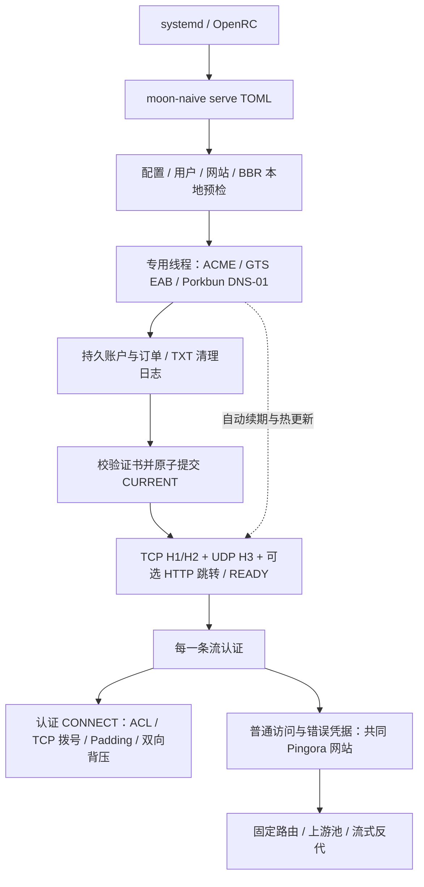

# VPS 安装、构建发布与服务端对照

网站统一使用真实固定源站：简单场景只填写 website.origin，无需网站目录、独立路由配置或证书配置文件。

> 当前源码为0.6.0 / moon-naive；官方Naïve客户端与修订4之前的moon-naive客户端不兼容。构建、TOML和服务管理步骤继续适用，历史互通结果不适用于新协议。新客户端要求和本轮证据见[PROTOCOL.md](PROTOCOL.md)与[VERIFICATION.md](VERIFICATION.md)。

**moon-naive：在 VPS 从源码构建、自动取证及与 Caddy 的差异**

构建和服务管理适用版本：0.6.0，Linux x86_64。当前支持的运行方式就是：构建一个 `moon-naive` → 填写 TOML → 启用 systemd/OpenRC → 程序自动取得证书并启动 H2/H3。首次签发、续期与代理在同一进程中；不需要额外启动 ACME worker、cron 或 certbot。

当前推荐一份 schema v2 私有 TOML：代理用户、Porkbun API 和 GTS EAB 内联，旧分文件格式可用 config migrate 合并。这里比较的是作者 Naïve fork 的 forwardproxy，而非只安装上游原版 forwardproxy。

生产示例需开放 TCP/UDP 443；启用 http_redirect 时还需 TCP 80。DNS-01 本身不需要 80。准备域名 A/AAAA、Porkbun API access 和对应 GTS 环境的 EAB。

**准备源码与工具链**

使用完整源码包，进入包含根 `Cargo.toml`、`Cargo.lock`、`core/`、`src/` 的目录。源码包不要求 Git 仓库元数据，也不要求另外克隆相邻的 Pingora、quiche、BoringSSL 仓库。Cargo 会依据锁文件下载固定 Git revision 和 crates；首次构建需要访问这些来源。

```sh
tar -xzf moon-naive-0.6.0-source.tar.gz
cd moon-naive-0.6.0-source
```

构建机需要 Rust 1.89+、C/C++、CMake、libclang、Perl 和 pkg-config。Rust 入口并不意味着无需 C/C++：BoringSSL 及相关原生依赖由 Cargo build script 一起编译。无需安装 Go、xcaddy 或 OpenSSL 开发库。

以下系统包安装、文件安装及服务操作以 root 执行；Rust 构建可以使用普通登录用户。系统包选择一组：

```sh
# Debian 12/13
apt-get update
apt-get install -y build-essential cmake clang libclang-dev pkg-config perl git curl ca-certificates

# Arch Linux：保持系统同步升级
pacman -Syu --needed base-devel cmake clang pkgconf perl git curl ca-certificates

# Alpine 3.22：与已验证的 musl 工具链一致
apk add --no-cache build-base cmake clang19-libclang llvm19-dev linux-headers perl pkgconf git curl ca-certificates binutils file tar openrc libcap-utils
```

若未安装 rustup，可用官方安装器安装已验证的 Rust 版本；已有 rustup 时只需安装该 toolchain：

```sh
curl --proto '=https' --tlsv1.2 -sSf https://sh.rustup.rs -o /tmp/moon-naive-rustup-init.sh
sh /tmp/moon-naive-rustup-init.sh -y --profile minimal --default-toolchain 1.89.0
. "$HOME/.cargo/env"
rustc +1.89.0 --version
cargo +1.89.0 --version
```

已有 rustup 的情形：

```sh
rustup toolchain install 1.89.0 --profile minimal
```

**Debian / Arch：直接 Cargo 构建**

在源码根目录执行：

```sh
cargo +1.89.0 build --release --locked -j 2 -p moon-naive
./target/release/moon-naive --version
```

输出是 `target/release/moon-naive`。`-j 2` 限制并行编译；小内存机器可改成 `-j 1`，实际可用内存仍需容纳 C++/链接步骤。后续安装时执行：

```sh
install -m 0755 target/release/moon-naive /usr/local/bin/moon-naive
```

这是本发行版的 GNU 构建，通常依赖其 glibc/libstdc++；适合在该 VPS 构建并运行。不要把 Debian 上产生的 GNU 二进制直接用于 Alpine。

**Alpine 3.22：静态 musl 构建**

Alpine 的 musl Rust host 默认静态链接 build script，但 bindgen 要在构建时动态加载 libclang。项目提供了 Rust wrapper：host build script/proc-macro 使用动态 CRT，最终目标继续静态链接。显式 `--target` 用来区分两者。

```sh
mkdir -p target/build-support
rustc +1.89.0 --edition=2024 -C target-feature=-crt-static \
  xtask/build-support/musl-host-rustc.rs \
  -o target/build-support/moon-naive-rustc-wrapper

moon_naive_gcc_headers="$(gcc -print-file-name=include)"
RUSTC_WRAPPER="$PWD/target/build-support/moon-naive-rustc-wrapper" \
LIBCLANG_PATH=/usr/lib/llvm19/lib \
BINDGEN_EXTRA_CLANG_ARGS="-isystem $moon_naive_gcc_headers" \
RUSTFLAGS="-C target-feature=+crt-static" \
cargo +1.89.0 build --target x86_64-unknown-linux-musl --release --locked -j 2 -p moon-naive

./target/x86_64-unknown-linux-musl/release/moon-naive --version
file target/x86_64-unknown-linux-musl/release/moon-naive
install -m 0755 target/x86_64-unknown-linux-musl/release/moon-naive /usr/local/bin/moon-naive
```

最终程序应为 static PIE，且 `readelf -l` 无 INTERP、`readelf -d` 无 NEEDED。构建工具需要 libclang，不代表最终静态程序运行需要 libclang。Alpine 其他版本若使用不同 LLVM 版本，需要同步调整包名和 `LIBCLANG_PATH`。

若希望在 Debian/Arch 构建同样的跨发行版静态文件，可以使用项目固定的 Alpine Docker 工具链：

```sh
docker build -f deploy/Dockerfile.musl --target export --output type=local,dest=out/musl .
install -m 0755 out/musl/moon-naive /usr/local/bin/moon-naive
```

Docker 仅用于构建；运行 systemd/OpenRC 不需要 Docker。固定工具链、CA secret 及验证命令见本页的构建与发布检查。

**安装用户、配置和网站**

以下是首次安装；已有服务用户或配置时保留现有内容。Debian/Arch 创建用户：

```sh
useradd --system --user-group --home-dir /var/lib/moon-naive --shell /bin/false moon-naive
```

Alpine 对应命令：

```sh
addgroup -S moon-naive
adduser -S -D -H -h /var/lib/moon-naive -s /bin/false -G moon-naive moon-naive
```

安装配置与文件：

```sh
install -d -m 0750 -o root -g moon-naive /etc/moon-naive
install -d -m 0700 -o moon-naive -g moon-naive /var/lib/moon-naive
moon-naive config init /etc/moon-naive/config.toml
chown moon-naive:moon-naive /etc/moon-naive/config.toml
```

主配置只填写基础字段，高级参数按需添加（完整中文注释已在生成的文件中）：

| 字段 | 填写内容 |
| --- | --- |
| `domain` | 实际代理主机名，例如 `proxy.example.dev` |
| `acme.dns_zone` | Porkbun 托管的注册 zone，例如 `example.dev` |
| `acme.contact` | 实际联系邮箱 |
| `acme.issuer` / `environment` | `google` / `production` |
| `acme.accept_terms` | 接受所选 CA 条款后设为 `true` |
| `proxy.users` / `acme.dns_credentials` / `acme.eab` | 在同一主文件填写代理用户、Porkbun key 和 GTS EAB |
| `website.origin` | 实际固定源站，如 `http://127.0.0.1:8080` 或 `https://origin.example.net` |

用户、Porkbun API 与 GTS EAB 均填写在同一文件，详见 [配置与自动证书](CONFIGURATION.md)。模板中的凭据全部是占位值，`accept_terms` 默认false。编辑后保持0600及服务用户所有权。

Porkbun 必须实际提供该 zone 的权威 DNS，且域名已启用 API access；仅在 Porkbun 注册、却把 NS 委派到其他服务商，不符合当前 `dns_provider = "porkbun"` 配置。GTS production EAB 与 staging EAB 分开。`.dev` 浏览器访问需要 production 受信任证书，staging 不能替代。

主机名 A 指向 VPS；示例只绑定 IPv4，勿保留没有实际 IPv6 监听/路由的 AAAA。开放入站 TCP/UDP 443；默认不监听 TCP 80；需要跳转时增加 `listener.http_redirect`，DNS-01 本身不需要80。VPS 需要正常出站 HTTPS、DNS 及代理目标 TCP 网络，CAA 如有配置应允许 `pki.goog`。按 [CONFIGURATION.md](CONFIGURATION.md) 配置固定网站反代路由，源站需提供真实维护的内容。

**启动前检查**

```sh
moon-naive check-config /etc/moon-naive/config.toml
moon-naive check-transport /etc/moon-naive/config.toml
```

完整本地检查要以服务用户执行。Debian/Arch：

```sh
runuser -u moon-naive -- moon-naive check /etc/moon-naive/config.toml
```

Alpine：

```sh
su -s /bin/sh moon-naive -c '/usr/local/bin/moon-naive check /etc/moon-naive/config.toml'
```

`check` 不创建 CA 账户/订单，不改 DNS，不监听；会读取私有配置、检查网站、初始化状态目录/锁。首次 `certificate_ready=false` 是正常结果。运行中的服务使用 `status`，不要再运行会取得同一单写锁的 `check`/`acme once`。

默认使用系统 TCP 算法与 QUIC cubic。显式选择 TCP BBR 后，不可用时会在预检失败，不会静默改用其他算法。可以先查看 `sysctl net.ipv4.tcp_available_congestion_control`；模块加载由宿主管理员完成。QUIC 的 `bbr2` 是 quiche 用户态实现，与 TCP 内核名为 `bbr` 的算法分开。程序不修改全局 sysctl/qdisc。

支持BBR的VPS可以在同一TOML中启用：

```toml
[transport]
tcp_congestion = "bbr"
quic_congestion = "bbr2"
```

运行`moon-naive check-transport /etc/moon-naive/config.toml`查看读回的算法与接收窗口。0.6.0在TCP监听前设置策略；Linux QUIC使用高精度timerfd，不要求额外权限或配置。TCP仍由内核pacing，QUIC仍遵守quiche的发送时间，并不把UDP交给内核TCP BBR。

```sh
sysctl net.ipv4.tcp_available_congestion_control net.ipv4.tcp_congestion_control
sysctl net.ipv4.tcp_rmem net.ipv4.tcp_wmem
ss -tin '( sport = :443 or dport = :443 )'
tc -s qdisc show
```

在有持续传输的真实socket中核对`bbr`、`pacing_rate`、`delivery_rate`、`cwnd`、`rtt`及`rwnd_limited`/`sndbuf_limited`。`fq`能帮助内核执行pacing；现代Linux也有内部pacing回退，不能仅凭qdisc不是fq断言BBR失效。宿主机/云商还可能有外层限速。上述命令只读；不要在远程连接上盲目替换主机qdisc。

窗口应按带宽时延积和并发预算决定。例如100 Mbit/s、80 ms RTT约需要1 MB在途数据。H2上传受初始流窗口约束，下载受客户端窗口约束；H3接收窗口可增长到配置上限。提高`max_early_data_bytes`会同时提高认证前可缓存的数据，必须与`max_total_receive_bytes`及并发预算一起评估。保留默认值，先测出窗口受限再调；不以巨大固定TCP缓冲或假流量维持BBR状态。当前本地BBR/抓包证据见[VERIFICATION.md](VERIFICATION.md)，不代表已经修改或测量你的VPS。

**启用 systemd：Debian / Arch**

```sh
install -m 0644 deploy/moon-naive.service /etc/systemd/system/moon-naive.service
systemctl daemon-reload
systemctl enable moon-naive
systemctl start --no-block moon-naive
journalctl -u moon-naive -f
```

单元使用普通用户与 CAP_NET_BIND_SERVICE，首次取证过程中状态为 activating。`event=certificate_wait` 表示尚未开放代理端口；`event=server_ready` 并发送 READY 后成为 active。也可直接 `systemctl enable --now moon-naive`，该命令会等待首次就绪，CA/DNS 故障重试期间可能持续等待。

**启用 OpenRC：Alpine**

```sh
setcap cap_net_bind_service=+ep /usr/local/bin/moon-naive
install -d -m 0700 -o moon-naive -g moon-naive /var/log/moon-naive
install -m 0755 deploy/moon-naive.openrc /etc/init.d/moon-naive
rc-update add moon-naive default
rc-service moon-naive start
tail -f /var/log/moon-naive/server.log
```

OpenRC 的 running 只表示进程存活，就绪仍看 `event=server_ready`。升级替换二进制后重新执行 setcap。使用高于 1023 的端口时无需此文件 capability。

以上两种服务均只运行：

```sh
/usr/local/bin/moon-naive serve /etc/moon-naive/config.toml
```

不必先执行 `acme once`。签发、验证、安装、开放端口、续期与证书热更新均在此进程内自动完成。`moon-naive status /etc/moon-naive/config.toml` 只报告本地证书，不证明服务进程和公网连通性；网站可用 `curl --http1.1 https://你的域名/` 验证；代理必须使用实现本项目修订4的配套客户端，官方 NaïveProxy 不能用于成功代理验收。

**启动和请求的作用原理**



已有有效证书时直接复用；无有效证书时业务端口保持未绑定。续期失败继续使用尚有效证书；过期后拒绝新握手。SIGTERM/SIGINT 停止接入、排空已有连接并清理拥有的 TXT；崩溃未完成的操作由 journal 恢复。不要清空状态目录来重试。

H2 网站直接进入 Pingora HttpProxy；H3 网站通过有界内存 H2 桥进入同一个引擎，隧道不经过该桥。网站固定 upstream 与 Naïve 目标拨号分开：配置的 `/api/ -> 127.0.0.1:3000` 是网站反代，不是把代理用户的 CONNECT 转交给另一台代理。


## CPU 自动适配与延迟优化（0.6.0）

默认构建保持通用x86_64基线，程序在**部署主机运行时**检测CPU及操作系统是否允许使用相应SIMD状态，不把构建机器的CPU型号写死。运行：

```sh
moon-naive status
moon-naive check-transport /etc/moon-naive/config.toml
```

输出包含`cpu_arch`、`cpu_avx2`、`cpu_sha`、`cpu_aes`、`cpu_pclmulqdq`、`cpu_avx512f`等能力，以及`header_scan=memchr-runtime`、`sha256=sha2-runtime`、`tls_crypto=boringssl-runtime`。短输入和不同密码套件可选择不同实现；能力为true不等于所有函数都使用该指令集。仅输出在本地CLI/启动诊断中，不加入HTTP响应。

HTTP响应头分隔符使用可复用的memchr Finder；H2/H3字段的NUL/CR/LF检查合并为一次memchr3。memchr在支持AVX2时使用相应路径，否则回退SSE2/通用实现。HMAC继续使用已有sha2运行时SHA-NI检测，TLS继续由BoringSSL选择AES/CLMUL等实现；没有自行重写密码算法。AVX-512只报告支持状态，本轮没有新增AVX-512专用内核。

无需`target-cpu=native`才能获得上述自动加速。若仅在同一台VPS本地编译和运行，可另行比较`RUSTFLAGS='-C target-cpu=native' cargo build --release --locked -p moon-naive`；这会让其他Rust代码也依赖该机器的CPU能力，产物不能再当作通用x86_64包迁移。交付和基准默认使用通用构建，没有开启全局AVX/AVX-512要求。架构匹配仍是前提，x86_64程序不能靠运行时检测变成ARM程序。

固定HTTPS下一跳在启动预检的阻塞线程上一次构建TLS上下文，消除每次隧道拨号重复读CA和初始化信任库的等待；每连接独立SSL状态、SNI/证书校验、TLS握手及成功后200保持。CA变更需重启，网站自身ACME证书仍热更新。性能数字只代表[验证记录](VERIFICATION.md)中的本地场景，不代表公网RTT、DNS等待或总代理吞吐的同等倍数变化。

## 构建与发布检查

一个 workspace、一个 Cargo.lock、一个服务程序。当前固定依赖：Pingora `4487f7b2ab50f159e4a2cf4f6a6b813f61bb6e19` 加 vendor 中已审计补丁；quiche `925b225825e2188f8e58e359114150500557bf61`；instant-acme `4a9b80fdc22f23ab39b78dfd20ff5d4c92938e52`。boring/boring-sys 为5.2.0，tokio-boring为5.0.0。vendor 校验清单与依赖锁保留。

```sh
cargo fmt --all --check
cargo test --workspace --locked
cargo clippy --workspace --all-targets --locked -- -D warnings
cargo build --release --locked -p moon-naive -p xtask
cargo run --locked -p xtask -- audit-native
cargo run --locked -p xtask -- verify
cargo run --locked -p xtask -- soak 100000
```

`verify` 运行 Debug/Release 检查与构建，通过实际二进制的 `config init` 创建私有样本再检查，验证旧开关拒绝和缺失凭据时启动失败。不会把源码中的0644公开模板直接当运行中的私有配置。`soak` 不等于24小时真实网络测试。

通用发布使用前述 Docker musl 构建。若构建网络需要私有CA，可加 BuildKit 临时 secret：`--secret id=system_ca,src=/path/to/combined-ca-bundle.crt`；不关闭 TLS 校验，不把私有 CA 文件写进镜像层或包。

```sh
cargo run --locked -p xtask -- dist out/musl/moon-naive dist
cargo run --locked -p xtask -- source dist
cargo run --locked -p xtask -- platform-smoke out/musl/moon-naive /etc/ssl/certs/ca-certificates.crt
```

打包拒绝覆盖同名 stage/archive，按排序及归一化的时间、owner、权限生成 tar.gz 和 SHA-256。二进制包包含唯一配置模板、systemd/OpenRC、当前文档、许可证、依赖与构建清单；源码包包含测试源码和历史记录，不含真实配置、状态、构建缓存或 reports。源码打包会读取 Git 文件清单，无 Git 元数据时先建立受 `.gitignore` 保护的基线。

`dist` 使用 goblin 检查 ELF，拒绝 INTERP/NEEDED 或常见 Go 构建段；源码审计的 Go 排除针对生产构建，不针对 tools/packet-lab 的独立实验工具。静态程序仍需宿主系统 CA bundle。`platform-smoke` 在固定 Alpine/Debian/Arch 镜像中以普通用户、只读文件系统检查同一静态二进制；可选 CA 参数允许只读 GTS directory 请求，不建账户或改DNS。检查结果不能冒充各发行版从源码构建、完整服务开机或公网验收。

### 外部验收与现有边界

默认 ignored 的真实 Chromium、官方旧客户端拒绝、Pebble、抓包和微基准测试需另行准备。示例环境：

```sh
export CHROMIUM_BIN=/absolute/path/to/chromium
export NAIVE_BIN=/absolute/path/to/official/naive
export PEBBLE_BIN=/absolute/path/to/pebble
export CHALLTESTSRV_BIN=/absolute/path/to/pebble-challtestsrv
export PEBBLE_SOURCE=/absolute/path/to/pebble-source
cargo test --workspace --locked -- --include-ignored --test-threads=2
```

抓包还需要 tools/packet-lab 的专门环境。可在 musl builder 用 `cargo test --target x86_64-unknown-linux-musl --workspace --locked --no-run --message-format=json` 保存构建 JSONL，再用 `xtask test-artifacts <jsonl> --include-ignored` 执行实际静态测试程序。编译成功/ignored不算执行通过。

本项目仍为0.6.0、协议修订4，尚未交付配套 Chromium 代理客户端。公网 Porkbun/GTS 签发、实际 VPS 开机/恢复、24小时负载/丢包/吞吐、ECH 双端闭环和 DPI 对照需另行验证，不能沿用旧版本或本地 CA 测试宣称完成。当前结果见 [VERIFICATION.md](VERIFICATION.md)，协议见 [PROTOCOL.md](PROTOCOL.md)，历史材料集中于 [HISTORY.md](HISTORY.md)。

## 服务端对照与 H1 路由

本轮弱点审查、协议设计及原版客户端已修复的MitM问题见[PROTOCOL.md](PROTOCOL.md)。

对照对象是作者 forwardproxy `v2.11.7-naive2`（e747854e78743dba85c039b38ed185fb11d93667，已补查原本地快照 c096d6a0 之后的修复）及客户端 d04efe1ea4477c2db24a7d0e2f068b3bee931e45（Chromium 154.0.8037.49）。这里的“原服务端”指 Caddy 加作者 forwardproxy，不把客户端 NaivePaddingSocket 的逻辑误认为 Caddy 插件已有的逻辑。Caddy 功能随版本和安装模块变化，未做完整跨版本等价性认证。

## 已有、未复现与有意差异

| 能力 | 当前 moon-naive | 对照与原因 |
| --- | --- | --- |
| 普通 H2/H3 CONNECT、Basic 认证 | moon-naive，TLS1.3 exporter与流ID绑定HMAC；Basic不认证 | 主动放弃旧客户端兼容，每流独立，成功响应证明 |
| 数据 Padding Variant 1 | 协商8/16窗口及可选稀疏后段，详见PROTOCOL.md | 无空闲假流量，不改反代正文 |
| 记录大小 | 16309字节有效数据上限，3字节记录头，最多63字节初期padding | 原Go复制路径约64KiB缓冲；不据读块大小推断伪装效果 |
| CONNECT 响应 Padding | 删除随机Padding响应头；只保留固定58字节值的绑定证明，H2标记never-index | 减少装饰性随机首部；HPACK/QPACK仍可能改变编码长度，需实测 |
| 客户端主动 100..200 字节碎片 | 不在 Rust 下载方向复制 | 这是客户端写往代理方向的 NaivePaddingSocket 策略，作者 Go 服务端不是这样逐块发送；复制会增加额外小写入 |
| 初期短响应扩充 | 未复制客户端该分支 | 同上；不能把客户端特定方向的策略无条件套到反向方向 |
| CONNECT 提前返回成功 | 有意不实现 | 作者插件先 200/Flush 再拨号；本项目遵循用户要求，先认证/ACL/拨号，成功后 200。首连可能多等拨号时间，但错误不会伪装为连接成功 |
| 认证隧道空闲 | 任一方向实际进展刷新，默认600秒 | 原服务端最新版本为认证H2/H3请求覆盖Caddy读取空闲期限为24小时，修复read_body_idle断流；硬期限仍有效，双方策略不等价 |
| 客户端 CONNECT 后提前上传 | 有界缓冲/流控与互通已覆盖 | 与服务端提前 200、TCP Fast Open、TLS 0-RTT 是不同事情。后两者继续关闭 |
| H1 CONNECT/通用正向代理 | 有意不开放 | 作者插件支持认证 H1 代理；本项目 H1 全部由固定网站反代引擎处理 |
| H2/H3 普通 HTTP(S) 正向代理 | 已有 | 外部 origin 需认证并受出站策略；本站请求仍是网站反代 |
| 未认证流量隐藏代理 | 固定网站路径，无 407，无隧道 Padding | 原插件也可关闭 probe resistance 并发 407；此可选模式未提供 |
| PAC、秘密域名认证提示页 | 未复现 | 不需要额外代理发现入口；按当前用途裁剪 |
| 多域名 Hosts 匹配、任意 Caddy 路由链 | 不等价 | 当前主站域名加可选 ECH 公开名称，最长文本路径前缀；ECH public_name 现在是同一固定网站的别名，不是独立的任意多站点配置 |
| 自定义 ACL、AllowedPorts 规则语言 | 未复现全部 | 当前使用固定公网地址安全策略及逐候选检查，不是原插件可编程规则系统 |
| HTTP(S)/SOCKS5 下一跳 | 已有 | 保留 TLS CA/主机名验证，不复制原插件对某些 localhost HTTPS 放宽校验的行为 |
| 网站反代、WebSocket、流式响应、trailer、gzip、H2 上游 | 已有相应实现与测试 | 不等价于完整 Caddy 生态；当前 H1 已知长度响应保留 Content-Length，未知长度使用 chunked，不能声称逐字复刻源站响应 |
| 静态文件、目录浏览、Caddy 插件/管理 API | 有意删除或未提供 | 网站内容由真实固定源站提供，减少服务器内置网站模块 |
| ACME | 主域名自动签发续期、Porkbun/GTS 路径已有 | 未等价于 Caddy 全部 issuer、challenge、多域名、集群存储能力；真实生产账户验收仍需要部署 |
| ECH | 实验性 H2/H3 接入 | 公开证书自动管理、DNS 自动发布、轮换及真实客户端闭环仍未完成；不把它算成完整支持 |
| TLS/H2/H3 指纹 | BoringSSL/Pingora/quiche 组合 | 不复制 Caddy Go TLS/HTTP2/QUIC 参数；语言或加密库切换不能单独证明抗识别提升 |

既有网站边界检查继续保留：清除进入反代的 fastopen 协商首部；严格检查 H1 Host 唯一性、HTTP/1.1 必需 Host、绝对 URI 与 Host 一致性（遵循 Pingora 的绝对 URI/Host 字节一致规则）。未知或畸形请求不触发任意目标拨号。本轮moon-naive改动认证和Padding格式，详细清理清单见[PROTOCOL.md](PROTOCOL.md)。

## H1 路由顺序

```text
TCP 443 → TLS → http/1.1 ALPN 或无 ALPN 回退（需 listener.h1=true）
  → H1 语法/首部长度/Host/消息分帧校验
  → 清理代理与伪造转发首部
  → 请求体大小检查
  → Host 主域名/已配置 ECH 公开名称检查
  → CONNECT 方法拒绝
  → 最长文本路径前缀
  → 管理员配置的源站池 → Pingora 反代/连接复用
```

H1 不进入 App 的 H2/H3 代理分发，因此正确密码也不能获得任意目标拨号能力。先发生的校验决定状态：例如 CONNECT 带超限 Content-Length 可以先得到 413，而不是总得到 405。

| 输入情况 | 当前动作/结果 |
| --- | --- |
| TCP 443 上直接发送明文 HTTP | TLS 层失败，不进入网站，不自动 308 |
| 协商 H1 或无 ALPN，且 h1=true | 进入网站 H1 引擎；有 TLS1.2/1.3 兼容 |
| h1=false | 不提供 H1 网站；无 ALPN 后也不进入 H1 路由 |
| SNI 与 HTTP Host 不同 | TLS 证书校验由客户端执行；握手成功后的主站路由按 Host 判断，没有把 SNI 当作代理认证或任意目标地址 |
| 主域名的 GET/POST/PUT/DELETE/OPTIONS 等 origin-form 请求 | 按路径匹配固定源站，方法/请求体交给源站；最终状态由源站决定 |
| HEAD | 同网站路由，客户端不接收正文，避免前端 gzip 改写 HEAD 语义 |
| 正确、错误、缺失、重复 Proxy-Authorization | H1 路由权限相同；这些代理凭据被删除，不传给源站 |
| Authorization（网站自己的凭据） | 保留给固定源站；不当作 Naive 代理凭据 |
| CONNECT target 与 Host 矛盾 | 在 Pingora 解析层拒绝，通常 400；不会进入方法路由 |
| 主域名 CONNECT | 在前置校验通过后返回 405 与普通错误正文；不联系目标，正确代理凭据也一样 |
| 未知 Host 的 CONNECT 或普通请求 | 前置校验通过后返回 404，不拨号任意目标 |
| 主域名 Host 带端口 | 主站匹配使用 host 部分；不因此选择其他源站 |
| Host 大小写不同 | 主域名比较忽略 ASCII 大小写 |
| Host 为 IP、其他域名或 ECH public_name | 仅配置主域名与 ECH public_name 可以进入固定反代；其他 Host 返回 404 |
| HTTP/1.1 缺少 Host、重复 Host、非法 Host 或 userinfo | 400/关闭，不进入源站 |
| HTTP/1.0 缺少 Host | 本层允许语法，但网站无可匹配 Host，返回 404；HTTP/1.0 有合法主域名则可反代 |
| GET https://本站/path，Host 与 URI 一致 | 路径进入固定反代；不是正向代理。authority 与 Host 需逐字节一致，包括端口写法和大小写 |
| 绝对 URI 的域名/端口与 Host 不一致，或不支持的 scheme | 400/关闭 |
| 绝对 URI 与 Host 一致，但都为外部域名 | 404；不会访问该域名 |
| 路径无匹配 route | 404；没有静态文件或内置首页兜底 |
| 路径匹配 | 按前缀长度降序选择，strip_prefix 与 query 保留规则生效；是文本前缀，/api 也可能匹配 /apix，需用 /api/ 表达目录边界 |
| OPTIONS * | 不匹配以 / 开始的配置路径，按当前路由为 404，不当作代理探测能力接口 |
| WebSocket Upgrade | 主域名/路径匹配后只访问固定源站，源站接受 101 才升级；不授予任意地址隧道 |
| SSE/Range/流式响应 | 固定反代；Range/206、SSE、gRPC/no-transform 等按现有规则抑制 gzip，维持流式行为 |
| 请求声明/实际正文超过限制 | 413；声明长度超限可以在 Host/方法分发前拒绝 |
| CL+TE、重复/非法 CL、非法 TE、折行、非法 CRLF、危险 Connection 提名 | 400/关闭，源站不接收歧义请求；底层解析失败也可能直接关闭 |
| 超大/过多首部、慢速不完整请求头 | 拒绝或关闭；完整头部期限 10 秒，原始头 32 KiB/128 字段上限 |
| keepalive | 允许复用；空闲有期限，每连接最多 1000 次请求，不跨请求继承代理认证 |
| 固定源站连接/读取失败 | 普通反代错误，典型 502；超时状态随 Pingora 失败层决定，不回退直连其他任意地址 |

网站反代清除 Proxy/Proxy-Authorization/Proxy-Authenticate/Proxy-Connection、Padding 系列、fastopen 及对应已定义的 CGI 别名，清除客户端伪造转发身份。保留正常网站首部，添加受信转发信息；不向普通网站响应添加隧道 Padding/407。正常网站响应及部分本地错误带 Alt-Svc；错误响应不保证全部经过同一首部处理阶段；RC4 已移除通用本地错误模板的 Server: Pingora，源站自己的 Server 字段仍保留。H1 的分帧、错误正文和关闭时间仍是可观察行为。

## 单独的明文 HTTP 跳转监听

仅在 listener.http_redirect 配置后存在，与 TCP 443 的 TLS 网站引擎不同：

| 请求 | 结果 |
| --- | --- |
| 单一合法主域名 Host、普通 /path?query | 308 到配置主域名的 HTTPS 地址；保留路径/查询，使用实际 TLS 端口 |
| Host 缺失或重复 | 400 |
| 未知/无法解析 Host | 404 |
| CONNECT target 与 Host 矛盾 | 在 Pingora 解析层拒绝，通常 400；不会进入方法路由 |
| 主域名 CONNECT | 405 |
| 主域名绝对 URI 或非 / 起始目标 | 400 |
| HEAD | 同状态与 Location，无正文 |
| 携带任何代理密码 | 不改变以上路由，不拨号 |

此监听使用 Hyper H1，关闭 keepalive，连接整体期限 30 秒，解析缓冲限制 32 KiB。
HTTPS 网站的 10 秒原始头校验不是这一监听的实现，不能混写成统一限制。

## 后续优先级

ECH公开名称路由和密钥文件热加载已有，完整证书/DNS自动化仍待补齐。当前已经改为moon-naive认证、协商窗口及可选稀疏后段；下一步是以拉取的Chromium构建项目实现新客户端，随后进行双端证书/撤销、ECH、会话恢复、H2/H3关闭行为和抓包对照。单纯增加随机数或人为延迟不保证不可识别。

## 2026-11-04：内核握手漏洞与长连接

先核对正在运行的宿主机内核，再启动对公网开放的TCP服务。CVE-2026-98432发生在IPv4 TCP握手的内核对象生命周期中，早于accept、TLS和逐流认证；应用层拒绝未认证请求、证书、BBR、Rust内存安全和关闭MPTCP均不能修复普通TCP路径。容器共享宿主内核，更新容器镜像也不能代替宿主升级。依据：[Linux CVE团队公告](https://kernel.googlesource.com/pub/scm/linux/security/vulns/+/refs/heads/master/cve/published/2026/CVE-2026-98432.mbox)、[AWS安全公告](https://aws.amazon.com/security/security-bulletins/2026-160-aws/)。

上游修复参照为5.10.272、5.15.223、6.1.190、6.6.159、6.12.113、6.18.56、7.2.10及7.3。发行版可能回补而不改变上游主版本：必须核对该发行版的安全公告、已安装内核包，以及重启后的`uname -r`；不要仅凭比较版本字符串宣布修复。安装修复内核后按发行版要求重启，使其真正运行。对Debian/Alpine/Arch采用各自包管理和内核公告，不混用其他发行版的内核包。

```sh
uname -r
moon-naive status
moon-naive check-transport /etc/moon-naive/config.toml
```

诊断输出`kernel_release`、`cve_2026_98432_version_reference`及对应的上游修复参照。`at_or_above_upstream_fix`只表示版本号落在参照范围；`below_upstream_fix_backport_unknown`仍需检查回补；`unknown`包括未收录分支/预发布内核。`kernel_patch_status=not_attested_verify_vendor`明确没有认证补丁状态。程序不自动升级/重启内核，也不以版本号阻止可能已回补的发行版启动。

暂时不能升级时，可在**宿主机**入口部署丢弃IPv4 IP options的规则。下面的独立nftables表不会清空既有规则；先以`nft --check -f 文件`检查，再由管理员在确认该网络不依赖合法IPv4 options后装载。默认策略accept不覆盖其他表的drop规则。覆盖PREROUTING而非只保护443，可同时经过宿主入站和容器转发路径；仍需检查实际网卡、命名空间和其他网络设备的位置。

```nft
table ip moon_naive_ip_options_guard {
  chain prerouting {
    type filter hook prerouting priority raw; policy accept;
    ip hdrlength > 5 counter drop comment "CVE-2026-98432 temporary IPv4 IP-options guard"
  }
}
```

这是IPv4头部IHL检查，**不是TCP options**检查，不禁用TCP timestamps、SACK、MSS或窗口缩放。规则会影响合法的IPv4 options用途；未启用持久化时重启后消失。回滚仅删除本表：`nft delete table ip moon_naive_ip_options_guard`。不要在未核实内核修复生效前移除临时防护；它不能替代内核修复。本轮在独立容器中通过语法检查、普通TCP/UDP通过、带合法NOP options的UDP被丢弃的测试，之后删除测试表，没有执行内核漏洞利用或修改生产VPS。

长连接默认`limits.idle_timeout_secs=600`指无应用数据进展的空闲时间，不是连接总寿命；数据持续流动可超过此值。根据真实业务的最长静默期设置它，保留`max_connections`、`max_streams`和总接收预算。高丢包时先确认MTU、拥塞/队列及应用超时，不通过无界缓冲、关闭拥塞控制、提前发送或永久保活来掩盖断流；超过空闲期限仍应回收。TCP BBR和QUIC BBRv2各自作用于其传输路径，不能把本地QUIC损伤试验当作TCP公网测试。
