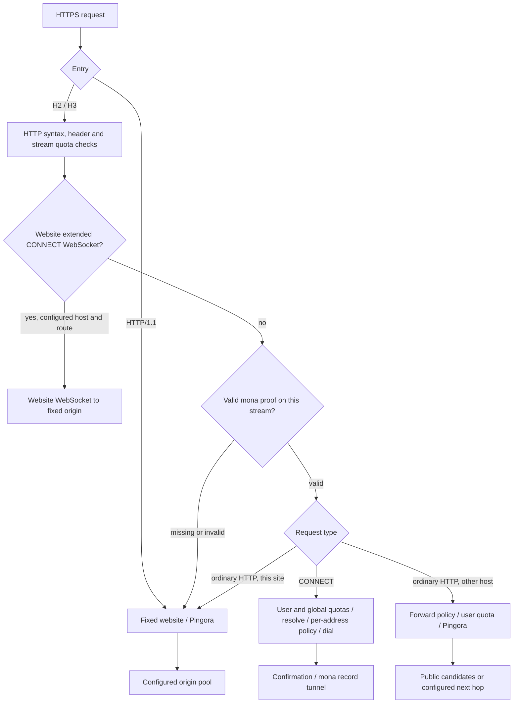

# Architecture

Moon-naive is one Rust server process for a single node with a few trusted
users and devices, plus a first-party Rust client. There is no database,
control-plane service, sidecar or inter-process RPC.

## Workspace

| Crate | Path | Role |
| --- | --- | --- |
| `moon-naive` | `src/` | Server binary and library: listeners, TLS/QUIC, website, tunnels, ACME |
| `moon-naive-core` | `core/` | Pure logic: configuration, ACL, per-stream authentication, record codec, ingress classification, destination policy. No I/O |
| `moon-naive-client` | `client/` | Client binary and library: local SOCKS5/HTTP CONNECT, mona proofs and records, transport policy |
| `moon-naive-engine` | `engine/bridge/` | Safe Rust wrapper over the C ABI of `libmoon_engine.so` (the only crate with `unsafe`) |
| Chromium native engine | `engine/` | Chromium's network stack as a shared library: TLS, H2, QUIC/H3, socket pools, cert verification |
| `xtask` | `tools/xtask/` | Verification, vector and source audits, TFO audit, laboratory orchestration, packaging |

## Server components and ownership

| Component | Responsibility |
| --- | --- |
| `src/runtime.rs` | Startup, readiness (`sd_notify`), SIGTERM draining, and supervision of the renewal controller |
| `src/cli.rs` | Commands: `serve`, `check`, `check-config`, `check-transport`, `status`, `acme …`, `ech …`, `config …` |
| `src/net/mod.rs` | Endpoint views, shared authentication and upstream state, transactional bind/close, post-authentication admission |
| `src/net/h2.rs` | TCP/TLS accept and the Pingora HTTP/2 session adapter; HTTP/1.1 website fallback when H2 is not negotiated |
| `src/net/h3.rs` | Single-owner QUIC/HTTP/3 driver (quiche): Retry tokens, stream state, receive credit, pacing |
| `src/net/site/` | Website and ordinary forward proxy over Pingora: fixed origin pools, header sanitizing, streaming, compression, WebSocket. H3 website traffic reuses Pingora through a bounded in-memory H2 bridge |
| `src/net/tunnel.rs` | mona CONNECT relay: record framing, backpressure, half-close, idle deadline |
| `src/net/egress.rs`, `src/resolve.rs` | Bounded resolution and dialing; policy on each concrete resolved address; HTTP/HTTPS/SOCKS5 next hops that never fall back to direct |
| `src/net/resources.rs`, `forward_cache.rs` | Layered global/endpoint/user/connection quotas and byte budgets; bounded upstream pool cache |
| `src/net/tls.rs`, `src/trust.rs` | BoringSSL TLS and ECH contexts, trust roots, immutable TLS generations swapped atomically |
| `src/acme/` | instant-acme (JWS, nonces, EAB, orders), DNS providers (Porkbun, Cloudflare), durable journal, certificate validation and installation, private health heartbeat |

The data plane runs on a multi-threaded Tokio runtime. The ACME/DNS
controller runs on its own OS thread with a current-thread runtime, so ACME
network waits and journal `fsync` never occupy data-plane threads.

### Long-lived tasks and failure policy

| Task | Owner | On failure |
| --- | --- | --- |
| Network drivers (TCP accept, QUIC driver per endpoint) | `runtime::serve_with` | Process exits with an error; the service manager restarts it |
| Renewal controller thread | `runtime::Control` | Supervised: after the thread is joined, a fresh `Manager` is reopened from the durable journal with exponential backoff (60 s doubling to 1 h; reset after one healthy hour). The network keeps serving the last valid certificate meanwhile |
| TLS generation reload | network, every 5 s | Invalid material is rejected and the last valid generation stays active; existing connections keep their generation |

Before startup the process waits for a valid certificate; listeners bind only
after it is verified, and all sockets bind transactionally (a partial bind
failure leaves no listener open).

## Request routing



- Authentication is per H2/H3 request stream, bound to the real TLS exporter
  and stream ID. HTTP/1.1 never offers proxy authentication.
- Missing, malformed, duplicated, replayed or misbound proofs never grant
  egress: proxy metadata is stripped and the request is routed to the website,
  so the answer is ordinary site content, 404 or 405, and no target DNS lookup
  or dial happens.
- Unauthenticated requests reach only the administrator-configured origins.
- A TLS-terminating CDN or reverse proxy changes the exporter and therefore
  cannot relay client proofs.

## Client components

| Module | Responsibility |
| --- | --- |
| `client/src/local.rs` | SOCKS5 (CONNECT, no auth) and HTTP CONNECT on one listener |
| `client/src/lib.rs` | Accept loop, tunnel limit, H3→H2 policy, the engine's authenticator (signs with the actual binding, verifies confirmations, refuses non-ECH when ECH is required), record relay with half-close |
| `client/src/tunnel.rs` | Proof creation, confirmation check, record framing with randomized padding |
| `engine/bridge/src/lib.rs` | Loads and version-checks the engine, maps callbacks to async reads/writes, catches panics at the boundary |
| `engine/src/net/tools/moon_engine/` | The engine: one `URLRequestContext`/`HttpNetworkSession` on its own IO thread; one `HttpProxyConnectJob` per tunnel through Chromium's shared H2/QUIC session pools |

```
local app ─SOCKS5/HTTP CONNECT─▶ client (Rust) ──C ABI──▶ libmoon_engine (Chromium net/) ──H2/H3──▶ server
                                   ▲  authorize(binding, authority) / verify(values)  │
                                   └──────────── callbacks on the engine thread ──────┘
```

Chromium's pools reconnect on demand after a connection closes. The QUIC
connection idles out after `quic_idle_timeout_secs` and is re-established on
the next request.

## Dependencies

| Dependency | Pin | Notes |
| --- | --- | --- |
| Pingora | `f86ffda5` (vendored patches in `vendor/pingora`) | HTTP/1.1, HTTP/2, website proxy |
| quiche | `7ccccc7b` | QUIC and HTTP/3, BoringSSL via the `boring` crate |
| BoringSSL | `boring`/`boring-sys` 5.5.0 | Server TLS 1.3, ECH, exporters; C/C++ by design |
| Chromium (NaiveProxy tree) | `engine/UPSTREAM_REVISION`, Chromium `engine/CHROMIUM_VERSION` | Client data plane (`libmoon_engine.so`), with `engine/chromium.patch` |
| instant-acme | `1909bed8` (vendored patches in `vendor/instant-acme`) | ACME protocol |

Exact revisions are in `Cargo.toml` and `Cargo.lock`. The patch rationale is in
[`vendor/pingora/MOON-NAIVE-PATCHES.md`](../vendor/pingora/MOON-NAIVE-PATCHES.md)
and [`vendor/instant-acme/MOON-PATCH.md`](../vendor/instant-acme/MOON-PATCH.md).
